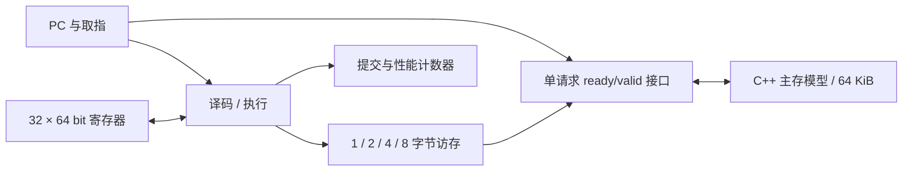
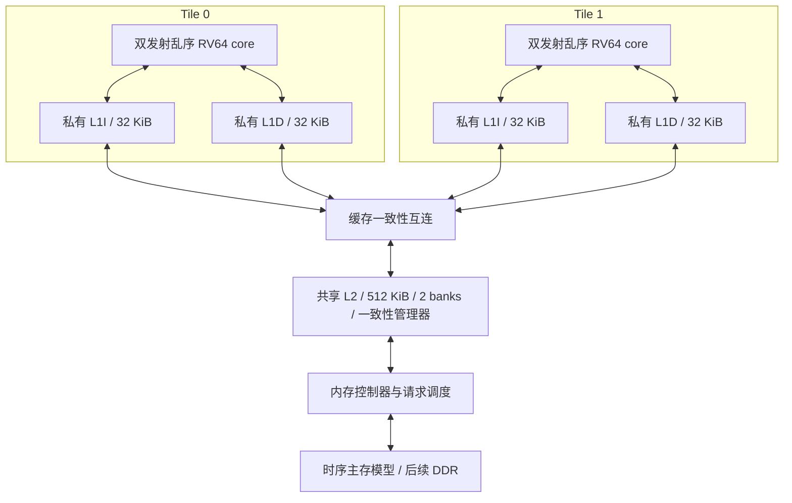

# 当前结构与演进目标

## 已实现的 RV64I 多周期单核



这是单发射、顺序、多周期状态机，复位 PC 为 0，每条指令依次经过：

```text
FETCH_REQ → FETCH_RSP → EXEC → 下一次 FETCH_REQ
                          ↓ Load/Store
                      DATA_REQ → DATA_RSP → 下一次 FETCH_REQ
```

请求与响应阶段均不重叠。普通指令在 EXEC 提交，Load/Store 在成功响应后提交。
寄存器 x0 始终读零并忽略写入。LUI 的 32 位结果按 RV64 语义符号扩展。
分支偏移相对当前指令 PC；JAL/JALR 写入 PC+4。指令固定 4 字节对齐，数据按访问大小自然对齐。
全部 52 条基础指令的覆盖及执行环境边界见 [RV64I 说明](rv64i.md)。

### 请求协议

| 信号 | 含义 |
|---|---|
| req_valid / req_ready | 两者同时为 1 的上升沿接收请求 |
| req_addr | 64 位字节地址 |
| req_write / req_wdata | 是否写入，以及 64 位数据 |
| req_size | 字节数的 log2：0/1/2/3 表示 1/2/4/8 字节 |
| rsp_valid / rsp_ready | 两者同时为 1 的上升沿接收响应 |
| rsp_rdata / rsp_error | 64 位返回值，以及访问错误 |

请求受阻时保持 valid 和全部载荷不变。系统最多一个未完成请求，无零周期响应。
响应在被接收之前保持稳定。当前无需事务 ID；升级为多个未完成请求时需增加 ID。
访问从 req_addr 起连续读写 `1<<req_size` 个小端字节，数据不按地址低位移到总线其他 lane。
这是连续访问大小协议，不是 AXI byte-lane/strobe 接口。SB/SH/SW 不改动访问范围以外的字节。
取指请求 size=2，读取四个字节；边界检查按真实宽度执行，0xffff 的单字节访问和 0xfffc 的取指都有效。
加载响应是零填充的原始位模式，core 再按 LB/LH/LW/LD 或无符号版本决定是否符号扩展。

内存模型在请求接收时执行写入，在配置的延迟后应答；由于当前无推测或并发访存，适用于此基线。
未来乱序核必须增加提交授权的 store buffer，不能直接沿用这个可见性假设。

### 地址约定

| 地址 | 用途 |
|---|---|
| 0x0000 起 | 汇编程序或 C 启动代码 |
| 0x0200 起 | 示例结果签名，bit_ops 使用到 0x023f |
| 0x1000 起 | 汇编示例的数据；C 链接布局则在此放置正文 |
| 0xd000–0xefff | C 示例预留栈区域，初始 sp=0xf000 |
| 0xfff0–0xfff7 | 仿真退出邮箱，仅提交的完整 SD 才触发退出 |
| 0x0000–0xffff | 统一 RAM；无其他外设、Boot ROM 或地址转换 |

汇编示例正文位于结果区之前；C 启动代码由链接断言限制在 0x200 之前，C 正文移到 0x1000。
生成的压力测试有独立布局，不能套用示例地址表。C 启动代码设置栈并清零 BSS，无 libc。

### 停止与错误

正常结束由宿主观察已提交的 SD 到 0xfff0，数据 0 表示成功。core 自身此时无需设置 halted。
ECALL/EBREAK 产生终止异常，不提交、不增加 instret；fault=4/5，cause=11（固定 M 环境）/3。
fault=1/2/3 分别表示非法指令、未对齐、总线错误。trap_pc/cause/value 保存精确定位信息。
异常指令不写回，也不会发出本应被对齐检查拒绝的访存。没有 mtvec/mepc/mcause CSR 或 MRET。
这是一种宿主处理的终止异常 EEI，不是完整机器态实现。详细原因码见 [RV64I 说明](rv64i.md)。
驱动退出码：正常为 0，输入/超时为 1，异常为 2，非零邮箱状态为 3。

## 后续目标：尚未实现



这些容量仅作为设计空间探索起点，不能预先认定最优。单核性能与多核吞吐量分别测量。

| 里程碑 | 工作与验收条件 |
|---|---|
| M0（已完成） | 多周期顺序核、延迟与反压、波形、综合检查 |
| M1（指令执行已补齐） | 52 条 RV64I、逐条参考模型、精确终止异常、裸机 C 已验证；成熟 ISS 交叉验证、正式合规及完整机器态仍待后续 |
| M2 | 根据瓶颈决定流水划分与取指/执行重叠；验证旁路、停顿、冲刷，与 M0 同程序比较 |
| M3 | 阻塞 L1I/L1D，再加非阻塞缓存；扫容量、相联度、MSHR、延迟 |
| M4 | 分支预测、双发射、重命名、ROB、发射队列、LSQ；顺序提交与恢复 |
| M5 | 双核、A 扩展、共享 L2、一致性互连；原子操作、FENCE、内存顺序测试 |
| M6 | 更多 banks / 主存并行性、真实 DRAM 时序；再扩展四核 |

M4 初始探索参数：ROB 64 项、整数物理寄存器 96 个、LQ/SQ 各 16 项。
M5 先验证两个核的共享数据与 MSI 协议，再研究 MESI、目录和扩展能力。
普通 AXI 互连不能自动提供私有缓存一致性；缓存一致性之外还必须验证 RISC-V 内存顺序语义。
I-Cache 的指令同步需要单独设计，不能假定 D-Cache 的协议自动覆盖指令修改。

后续性能判断以相同工作量的周期、综合频率、面积为依据，不能只比较 IPC。

## 参考资料

- [RISC-V 非特权 ISA](https://docs.riscv.org/reference/isa/unpriv/unpriv-index.html)
- [BOOM 流水线](https://docs.boom-core.org/en/latest/sections/intro-overview/boom-pipeline.html)
- [BOOM LSU](https://docs.boom-core.org/en/latest/sections/load-store-unit.html)
- [RVWMO](https://docs.riscv.org/reference/isa/unpriv/rvwmo.html)
- [Chipyard 内存层次](https://github.com/ucb-bar/chipyard/blob/main/docs/Customization/Memory-Hierarchy.rst)
