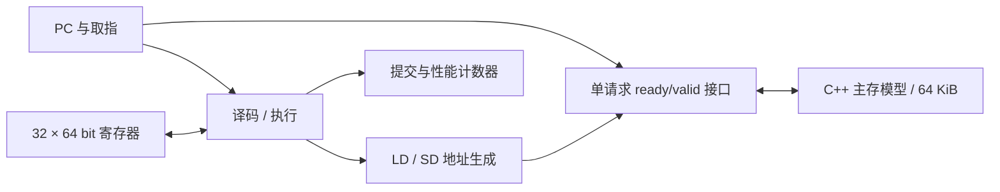
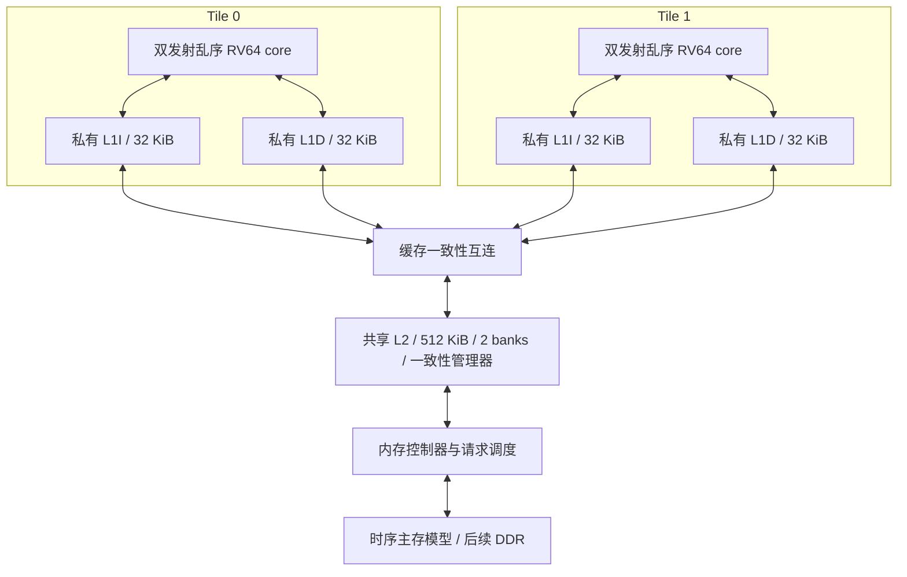

# 当前结构与演进目标

## M0：已实现的单核基线



这是单发射、顺序、多周期状态机，复位 PC 为 0，每条指令依次经过：

```text
FETCH_REQ → FETCH_RSP → EXEC → 下一次 FETCH_REQ
                          ↓ LD/SD
                      DATA_REQ → DATA_RSP → 下一次 FETCH_REQ
```

请求与响应阶段均不重叠。普通指令在 EXEC 提交，LD/SD 在成功响应后提交。
寄存器 x0 始终读零并忽略写入。LUI 的 32 位结果按 RV64 语义符号扩展。
分支偏移相对当前指令 PC；JAL 写入 PC+4。指令固定 4 字节对齐，LD/SD 固定 8 字节对齐。

### 请求协议

| 信号 | 含义 |
|---|---|
| req_valid / req_ready | 两者同时为 1 的上升沿接收请求 |
| req_addr | 64 位字节地址 |
| req_write / req_wdata | 是否写入，以及 64 位数据 |
| rsp_valid / rsp_ready | 两者同时为 1 的上升沿接收响应 |
| rsp_rdata / rsp_error | 64 位返回值，以及访问错误 |

请求受阻时保持 valid 和全部载荷不变。系统最多一个未完成请求，无零周期响应。
响应在被接收之前保持稳定。当前无需事务 ID；升级为多个未完成请求时需增加 ID、访问大小和字节使能。
当前每次模型访问均为从 `req_addr` 开始的 8 个连续小端字节；取指仅使用返回值低 32 位。
因此本模型中最后一个可访问起始地址为 0xfff8，不能视为完整的通用内存总线。

内存模型在请求接收时执行写入，在配置的延迟后应答；由于当前无推测或并发访存，适用于此基线。
未来乱序核必须增加提交授权的 store buffer，不能直接沿用这个可见性假设。

### 地址约定

| 地址 | 用途 |
|---|---|
| 0x0000 起 | 启动及程序指令 |
| 0x0200–0x0207 | 实验结果签名，仅供驱动读取 |
| 0x1000 起 | 数组 / 指针节点 |
| 0x0000–0xffff | 当前统一 RAM，无 MMIO / Boot ROM / 地址转换 |

现有程序机器码长度远小于 0x200，结果签名不覆盖代码。
扩展程序时必须重新规划链接布局，当前没有栈或 ABI 运行时。

### 停止与错误

`halted=1, fault=0` 表示执行 EBREAK，驱动正常结束。
EBREAK 当前会增加 instret，只是教学环境的结束约定，不是特权异常语义。
`fault=1/2/3` 分别表示不支持的指令、地址未对齐、总线访问错误。
错误指令不计入 instret，也不写回目标寄存器。没有 mtvec/mepc/mcause 或异常返回。
驱动在错误时退出码为 2，在超时或输入错误时为 1，正常为 0。

## 后续目标：尚未实现



这些容量仅作为设计空间探索起点，不能预先认定最优。单核性能与多核吞吐量分别测量。

| 里程碑 | 工作与验收条件 |
|---|---|
| M0（当前） | 指令子集、三个程序、延迟与反压、波形、综合检查 |
| M1（进行中） | 逐条提交、子集参考模型、19 条 OP/OP-IMM 整数计算指令已完成；继续补齐访存宽度、W 运算、寻址跳转、精确异常及成熟模型交叉验证 |
| M2 | 根据瓶颈决定流水划分与取指/执行重叠；验证旁路、停顿、冲刷，与 M0 同程序比较 |
| M3 | 阻塞 L1I/L1D，再加非阻塞缓存；扫容量、相联度、MSHR、延迟 |
| M4 | 分支预测、双发射、重命名、ROB、发射队列、LSQ；顺序提交与恢复 |
| M5 | 双核、A 扩展、共享 L2、一致性互连；原子操作、FENCE、内存顺序测试 |
| M6 | 更多 banks / 主存并行性、真实 DRAM 时序；再扩展四核 |

M4 初始探索参数：ROB 64 项、整数物理寄存器 96 个、LQ/SQ 各 16 项。
M5 先验证两个核的共享数据与 MSI 协议，再研究 MESI、目录和扩展能力。
普通 AXI 互连不能自动提供私有缓存一致性；缓存一致性之外还必须验证 RISC-V 内存顺序语义。
I-Cache 的指令同步需要单独设计，不能假定 D-Cache 的协议自动覆盖指令修改。

后续性能判断以相同工作量的周期、综合频率、面积为依据，不能只比较 IPC。

## 参考资料

- [RISC-V 非特权 ISA](https://docs.riscv.org/reference/isa/unpriv/unpriv-index.html)
- [BOOM 流水线](https://docs.boom-core.org/en/latest/sections/intro-overview/boom-pipeline.html)
- [BOOM LSU](https://docs.boom-core.org/en/latest/sections/load-store-unit.html)
- [RVWMO](https://docs.riscv.org/reference/isa/unpriv/rvwmo.html)
- [Chipyard 内存层次](https://github.com/ucb-bar/chipyard/blob/main/docs/Customization/Memory-Hierarchy.rst)
