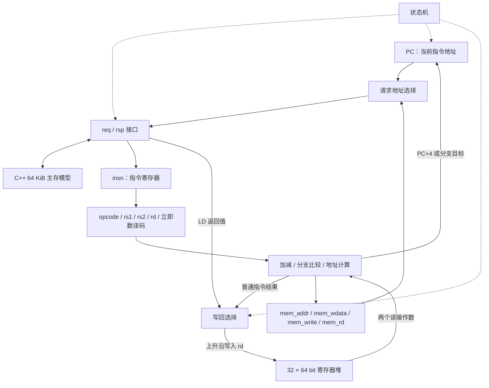
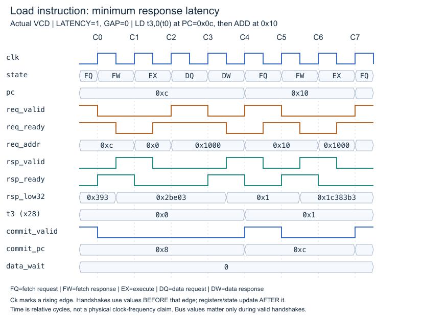
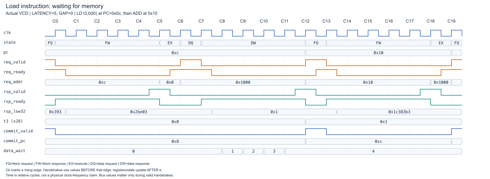
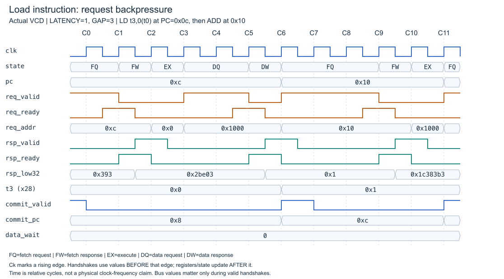

# 从数据通路到实际波形

本节以 RV64I 兼容配置的 LD 波形解释多周期工作过程，局部执行阶段保持最初 M0 的组织。
当前默认为模块化 RV64IMAC 和特权系统，参见 [默认实现](modular-core.md)；本页用 make diagrams 保留原波形对照。
正常退出现在使用邮箱 SD，EBREAK 产生终止异常；旧整程序周期见下方注明的历史值。
M0 是多周期顺序核：一个时刻只有一条指令在处理，取指和数据共用一条请求通路。

## 数据通路

这些是同一 RTL 模块内部的逻辑功能分组，并非已经拆分成多个独立模块。
RAM 与时钟驱动在 C++ 仿真环境中，不属于可综合 core。

`always @*` 负责组合译码与计算；输入变化时结果随之变化。
`always @(posedge clk)` 负责保存 PC、指令、寄存器、访存上下文和状态。
非阻塞赋值 `<=` 使各寄存器基于边沿前的状态更新。
因此在同一边沿令 `pc<=pc+4; commit_pc<=pc` 时，commit_pc 保存的是已完成指令的旧 PC。

## 为什么需要这些寄存器

| 寄存器 | 保存内容 | 原因 |
|---|---|---|
| pc | 当前指令字节地址 | 在指令完成前定位当前工作；普通提交后加 4 |
| insn | 返回的指令低 32 位 | 内存返回端稍后可能换成其他数据，执行不能直接依赖它 |
| regs[0:31] | 软件可见的整数寄存器 | 指令之间传递计算结果；x0 读零、写入丢弃 |
| mem_addr | 已算好的数据地址 | 请求反压和响应等待期间保持访存上下文 |
| mem_wdata / mem_write | SD 的源数据和读写类型 | 区分读写并保持稳定载荷 |
| mem_rd | LD 的目的寄存器编号 | 响应回来时知道应写哪个寄存器 |

这个寄存器堆是组合读、时钟沿写的 RTL 数组，不能把它直接理解为某种已选定的 SRAM 宏。

## 波形约定

以下图片由 `scripts/waveforms.py` 解析真实 Verilator VCD 生成，不是手工填充的示意数值。
`make diagrams` 可重新运行三个配置，并导出 SVG 和逐边沿 CSV；PNG 使用 rsvg-convert 导出。
C0 是第一条 LD 进入取指请求后遇到的首个上升沿，不是程序的全局第零周期。
各图重新对齐到自身的 C0，不能把不同图中的 Ck 当成相同绝对时间。

波形缩写：FQ=FETCH_REQ，FW=FETCH_RSP，EX=EXEC，DQ=DATA_REQ，DW=DATA_RSP。
虚线标出上升沿：握手看边沿前的 valid/ready，状态与寄存器更新看边沿后。
横轴是相对周期；仿真文件自身的时间刻度不表示已验证的工作频率。
`rsp_low32` 只画响应数据低 32 位；本例的 LD 数值为 1，因此没有遗漏高位信息。

## 第一张：LD 正常完成，LATENCY=1

本例执行 `ld t3,0(t0)`，此时 t0=0x1000，RAM[0x1000]=1，当前 PC=0x0c。

| 上升沿 | 边沿前判断或动作 | 边沿后结果 |
|---|---|---|
| C0 | 取指 valid=ready=1，地址 0x0c | FQ→FW |
| C1 | 指令响应 valid=ready=1 | insn 接收 LD，FW→EX |
| C2 | 计算 t0+0，保存地址、读标记和 rd=x28 | EX→DQ；t3 尚未写入 |
| C3 | 数据请求 valid=ready=1，地址 0x1000 | DQ→DW |
| C4 | 数据响应 valid=ready=1，返回 1 | t3←1，PC←0x10，LD 提交，DW→FQ |
| C5 | 取后面的 ADD，地址 0x10 | FQ→FW |
| C6 | ADD 指令响应到达 | FW→EX |
| C7 | 计算并写回 ADD 结果 | ADD 提交，PC←0x14 |

关键点：取到指令、发出读请求、数据返回、指令提交，是不同的事件。
LD 在 C2 只完成地址生成，直到 C4 才有数据并写回目的寄存器。
后续 ADD 需要 t3，当前设计直到 LD 提交才取它，因此没有流水线数据冲突，也没有旁路网络。

图左侧 commit_valid 还保留上一条 PC=0x08 指令的脉冲；必须同时看 commit_pc。
C4 边沿后 pc 已经是 0x10，但 commit_pc 是 0x0c，这是正常的“下一条地址”和“刚完成地址”的区别。
req_addr 和 rsp_rdata 在 valid 无效时仍可能显示旧值或改变，这不表示发生了新事务。

## 第二张：内存变慢，LATENCY=5

- C0 接收取指请求，C5 接收指令响应：相隔 5 个周期。
- C1–C4 的四个上升沿没有指令响应，fetch_wait 每次加 1。
- C6 计算访存地址，C7 接收数据请求，C12 接收数据响应。
- C8–C11 的四个上升沿没有数据响应，data_wait 从 0 加到 4。
- C12 才写回 t3、更新 PC 并提交 LD；下一条 ADD 到 C19 才提交。

与 LATENCY=1 相比，LD 从五个处理周期增加到十三个，多出的八个来自两次访问各多等四周期。
在 GAP=0 且正常结束时，当前实现普通指令用 L+2 周期，LD/SD 用 2L+3 周期。
因此整个程序可按 `cycles = instret*(L+2) + 数据访存次数*(L+1)` 核对。
初版 EBREAK 结束约定下，sum 有 325 条提交和 65 次数据访存，L=1 时 1105 周期，L=5 时 2665 周期。
当前邮箱退出版为 327 条提交、66 次数据访存，L=1/5 时分别为 1113/2685 周期。

## 第三张：请求尚未接收，GAP=3

这张图仍是 LATENCY=1，但内存只在驱动 tick 为 4 的倍数时允许接收请求。
图中 C0 取指 req_valid=1、req_ready=0，所以没有事务，直到 C1 才接收。
C4 的数据请求也被阻塞，core 保持 DQ、req_valid=1 和 req_addr=0x1000，C5 才完成握手。
C6 数据响应返回，LD 提交。后续取指在 C7/C8 继续受阻，C9 才接收。

这解释两个独立的等待：请求尚未被接收，和请求接收后等待响应。
当前 fetch_wait/data_wait 仅计算后者，所以本图 data_wait 一直为 0，但总周期仍然增加。
如果需要把所有停顿完全分解，后续还应增加请求反压计数器。

## 三条设计边界

1. req_valid 不依赖 req_ready，避免双方相互等候。阻塞时保持 valid 和载荷，防止地址丢失或写错位置。
2. 当前无推测、无并发访存。SD 在模型接收请求时更新 RAM，收到响应后才记为提交；未来乱序核需要提交授权的 store buffer，不能直接继承这个假设。
3. 非法指令或访问错误会产生终止异常；当前 ECALL/EBREAK 也如此处理，不提交。
   原始 M0 曾把 EBREAK 当结束标记，这一旧约定已移除；没有完整机器态 CSR 或异常返回机制。

## 如何从这个基线走向高性能

| 图中观察到的问题 | 下一步结构 | 新增验证重点 |
|---|---|---|
| 每条指令都要经过 RAM | L1I | 命中/缺失、取指重定向、指令同步 |
| 数据响应等待时 core 空闲 | L1D、更多未完成请求 | 缺失记录、返回匹配、读写顺序 |
| ADD 必须等 LD 完成才开始取指 | 流水线、旁路、冲突检测 | load-use 停顿、转发和冲刷 |
| 依赖某次访存的指令阻塞后续工作 | 重命名、ROB、乱序发射 | 真依赖、精确提交、推测恢复 |
| 只有一个软件线程在运行 | 多核和共享缓存 | 一致性、原子操作、内存顺序 |

先比较相同负载的结果与周期，再结合综合与时序，才能判断优化是否有效。
