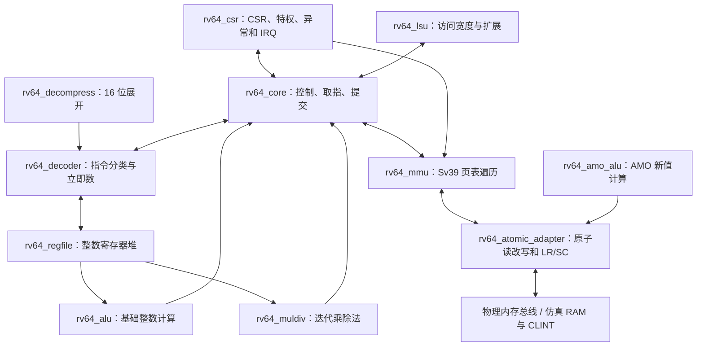

# 模块化 RV64IMAC、特权控制与 Sv39

## 默认配置和保留基线

默认 RTL 参数为 `EXTENSIONS=1, HOST_TRAPS=0`：RV64IMAC、Zicsr、Zifencei，M/S/U 特权模式，
指令边界中断和 Sv39/Svade 地址转换。仍是单发射、多周期顺序核，没有流水线重叠或缓存。

`make sim`、`make diff` 和 `make wave` 使用此配置。
另保留 `EXTENSIONS=0, HOST_TRAPS=1` 的 RV64I 兼容配置，仅用于旧回归、周期对比和原波形。
它保存在 build/obj_dir，默认扩展配置保存在 build/full_obj。
`make test` 运行两套；`make test-base` / `make test-full` 可以分别运行。
两种参数组合有完整回归，其他调试参数组合未单独验证。

## 模块如何连接



| 文件 | 责任 |
|---|---|
| rtl/rv64_core.sv | 连接模块，控制状态、半字取指、提交及异常优先级 |
| rtl/rv64_decoder.sv | 指令分类、立即数、分支/跳转地址、控制标记 |
| rtl/rv64_alu.sv | 原有 19 条整数运算和 9 条 W 运算 |
| rtl/rv64_regfile.sv | 32×64 位寄存器，组合读、同步写，x0 硬接零 |
| rtl/rv64_muldiv.sv | M 扩展，32/64 次迭代，避免组合除法器 |
| rtl/rv64_decompress.sv | RV64C 整数形式展开成内部 32 位指令 |
| rtl/rv64_lsu.sv | 1/2/4/8 字节原始数据截取与符号/零扩展 |
| rtl/rv64_amo_alu.sv | AMO 的新值计算，包含 W 的有/无符号比较 |
| rtl/rv64_atomic_adapter.sv | 锁定读改写、LR/SC 保留状态和 SC 权限探测 |
| rtl/rv64_csr.sv | CSR 访问权限与 WARL、M/S/U、异常委托、向量、返回、中断 |
| rtl/rv64_mmu.sv | Bare/Sv39、权限检查、4 KiB/2 MiB/1 GiB 页、Svade |

拆分先通过了全部旧回归，旧配置的周期数保持一致。源码分文件本身不增加执行并行度。

## M：实际的多周期计算单元

支持 MUL/MULH/MULHSU/MULHU、DIV/DIVU、REM/REMU，及 MULW/DIVW/DIVUW/REMW/REMUW。
使用移位累加和 radix-2 长除法：64 位运算 64 次迭代，W 运算 32 次迭代，另有启动/提交开销。
高位有符号乘积、除零、最小负数除以 -1、余数符号和 W 符号扩展均有黄金结果测试。
等待计算期间不开始另一条指令，中断在该条完成后进入。

## A：原子性在 RTL 中实现

支持 .W/.D 的 LR、SC 和 AMOSWAP/ADD/XOR/AND/OR/MIN/MAX/MINU/MAXU，包括 aq/rl 编码。
由于整个核按顺序完成内存事务，当前执行比 aq/rl 所需顺序更保守。

普通 AMO 在适配器中执行：锁定物理总线、读取旧值、计算新值、写入、确认后返回旧值。
它不依靠 Python 或 C++ 帮忙执行原子运算，C++ 目标仍只提供普通读写。
AMO.W 只更新低四字节，写回 rd 的旧值按 32 位符号扩展。

LR 记录物理地址和宽度；SC 先进行写权限探测，再在锁定期间检查保留并决定是否写入。
失败 SC 也通过 MMU 权限检查和物理访问探测，不能绕过保护；失败不写入，返回 1，成功返回 0。
物理总线新增 `req_store_check`：这是一次不写数据的写权限探测，接其他 PMA/总线目标时也必须检查写权限。

保留会在 SC、普通写、异常/中断、返回、SFENCE 和外部失效时被清除，属于保守的保留策略。
`reservation_invalidate` 是外部失效输入；`bus_lock` 是原子事务的互斥要求。
接多主互连时，必须让仲裁器在锁定事务期间保持所有权，并正确传递其他写入引起的失效。
不能仅连接普通读写总线就声称有多核原子性或缓存一致性。当前验证平台只有一个内存主设备。
保留以物理地址比较，两个虚拟地址映射同一物理位置的 LR/SC 别名成功路径已测试。

## C：取指长度和跨页处理

支持 RV64C 的整数寄存器、算术、分支/跳转、栈访存、普通访存和断点形式。
F/D 未实现，所以需要浮点扩展的压缩编码被拒绝；保留编码产生非法指令异常，HINT 不写架构结果。

扩展配置先取两字节：若低两位不是 11，则按 C 指令展开，PC 通常加 2；
否则再单独读取后两字节，组合成 32 位指令，PC 通常加 4。
两半分别经过地址转换，因此能处理始于页末半字、跨到非连续物理页的 32 位指令。
第二页缺页时，epc 保留指令起点，tval 报告第二半所在地址。
提交保留原始 16/32 位机器码，`bytes` 标明长度；参考模型自行展开，不使用 DUT 展开的指令。

## CSR 与特权模式

六条 CSR 操作为 CSRRW/CSRRS/CSRRC 及其立即数版本。
检查 CSR 是否存在、当前权限以及写意图；CSRRS/CSRRC 的 rs1=x0 才抑制写，
“非 x0 寄存器恰好保存零”仍是写操作。立即数版本也按字段是否为零判断。

已实现的主要 CSR：

- M：mstatus/misa、medeleg/mideleg、mie/mip、mtvec、mscratch、mepc/mcause/mtval、mcounteren、mcountinhibit、mcycle/minstret。
- S：sstatus、sie/sip、stvec、sscratch、sepc/scause/stval、scounteren、satp。
- 计数与标识：cycle/time/instret、mvendorid/marchid/mimpid/mhartid/mconfigptr。

misa 固定报告 I/M/A/C/S/U，UXL/SXL 固定 64 位；不支持的 CSR 报非法。
PMP 项数为零，没有 PMP CSR；Bare 模式不提供额外物理内存隔离，不能把本实验当成安全隔离系统。
未实现 H/F/D/V、调试、Sstc、性能事件等可选 CSR 家族。
satp 支持 Bare 或 Sv39，ASID 硬接零；不支持的 MODE 写入被忽略。
sip 只允许修改已委托的 SSIP，STIP/SEIP 对 S 为只读；M 环境可以通过 mip 软件部分控制对应待决位。
SEIP 的 CSR 读改写不会把外部电平错误锁存进软件待决位。

默认异常在硬件保存 epc/cause/tval，更新中断使能栈和来源特权级，跳到 mtvec 或 stvec。
低特权异常可通过 medeleg/mideleg 委托给 S；M 自身异常不会向下委托。
MRET/SRET 恢复特权和中断状态，TVM/TSR/TW、MPRV、SUM、MXR 和计数器访问权限均有测试。
MRET/SRET 是返回，不是软件模拟；ECALL/EBREAK 不增加 instret。

## 中断和时钟环境

输入 `irq_pending[63:0]` 提供已同步到 clk 的 M/S 软件、定时器、外部中断电平。
核按 mie/mip、特权级和全局使能，在第一半取指之前的指令边界决定是否进入。
优先级是 MEI、MSI、MTI、SEI、SSI、STI。mtvec/stvec 支持 Direct 和 Vectored。
WFI 当前按允许的提示行为执行，不做低功耗停钟；pending IRQ 仍会在下一边界检查。
CDC 同步器和完整 PLIC 属于平台层，本模块不包含它们。

仿真平台提供最小 CLINT：

| 物理地址 | 功能 |
|---|---|
| 0x02000000 | MSIP，写 0/1 清除/置位机器软件中断 |
| 0x02004000 | mtimecmp，设置机器定时器比较值 |
| 0x0200bff8 | mtime，只读，仿真有效周期数 |

`time_value` 是平台时间输入；架构 mcycle/minstret 可写并受 mcountinhibit 控制。
调试输出 cycles/instret 始终统计实际时钟/成功提交，不能与被软件改写或抑制的架构计数器混淆。
外部 IRQ 测试文件每行是 `cycle mask`；mask 的 bit63 用于保留失效脉冲，bit1/3/5/7/9/11 用于 IRQ。
文件是驱动最后一个可选参数，周期从 1 开始，状态持续到下一行修改。

## Sv39 MMU 与 Svade

MMU 位于原子适配器之前，页表读取使用物理地址，取指和数据地址独立传入同一个串行遍历器。
支持三级页表、4 KiB/2 MiB/1 GiB 叶子、规范地址、V/R/W/X/U、保留位和超级页对齐检查。
SUM/MXR 决定 S 数据访问规则；S 不能执行 U 页。MPRV 只改变 M 模式数据访问权限，取指不受影响。
页表访问失败报告原访问的 access fault，权限/格式错误则报告 instruction/load/store page fault。

没有 TLB，每次转换都读取当前页表，因此 SFENCE.VMA 是串行边界，不需要额外缓存失效。
采用 Svade：A=0 或写入时 D=0 产生缺页异常，由处理程序设置位并返回重试；不声称硬件自动更新 A/D。
回归中的处理程序用 AMOOR.D 更新 PTE，保存并恢复被中断程序的寄存器，再在原 epc 重试。
启用 satp 后也能通过虚拟映射访问物理退出邮箱。

## 直接运行

```bash
make diff PROGRAM=machine_demo  # 处理三个异常后返回，结果为 3
make diff PROGRAM=full_demo     # M/A/C/CSR 的 C 程序，结果为 949
make wave PROGRAM=machine_demo
make test-full
make test-base
```

machine_demo 刻意使用 32 位指令，处理程序可固定把 mepc 加 4。
通用异常处理程序需要依据异常类型和原始指令长度决定跳过、重试还是终止；不能一律加 4。

## 验证证据与限制

- 旧配置全部 RV64I、ALU、W、访存、C 编译程序回归仍通过，周期计数保持一致。
- 默认扩展配置按实际提交和软件 trap 记录逐条对照独立 Python 模型，最后比较全部物理 RAM。
- M 有 247 组数学黄金向量；A 有 154 个旧值/新值/保留结果黄金观测值。
- C 验证整数形式、最大栈/普通偏移、负立即数、混合长度、保留编码和跨页。
- 软件异常、M/S/U、委托、向量中断、CLINT 和外部 IRQ、WARL、计数器、保护位均有程序测试。
- Sv39 验证 U/S 权限、SUM/MXR/MPRV、A/D 修复重试、别名原子访问、页表重映射、超级页、保留位和跨页异常定位。
- 扩展 C 程序在 -O0/-O2 下运行，编译后确认含真实 MUL/DIV/REM、AMO、LR/SC 和压缩指令。
- 检查器测试故意损坏压缩长度、特权、原子字段、trap 定位、IRQ 输入、MMIO 时间和物理 RAM，必须失败。

本轮从清空 build 开始运行 lint、全部仿真及综合映射：兼容配置保留 71 次基础、5 次 ALU 压力和 126 次 RV64I 专项运行；
默认配置另有 40 次扩展和 86 次特权运行。两套检查器分别有 13 和 7 项测试。
Verilator lint 无警告，Yosys 结构检查为零问题。Nangate45 typical 和当前约束下，
OpenSTA 的布局前最小时钟周期估计约 19.64 ns，仍不满足设定的 10 ns，不能作为硅片频率承诺。

这些是课堂实验规模的定向、边界和部分固定种子向量验证，尚无 Spike/Sail 交叉验证或正式 ISA 合规证明。
没有实际多主一致性验证、缓存、PMP、真实 DRAM 控制器、完整设备树/引导环境或 Linux 启动测试。
功能扩展没有让 core 自动变成高性能处理器；M 运算和无 TLB 遍历都引入等待周期，需后续按负载优化。

## 规范依据

- [Machine 特权与 CSR/异常/中断](https://docs.riscv.org/reference/isa/v20260120/priv/machine.html)
- [Supervisor、Sv39 与 Svade](https://docs.riscv.org/reference/isa/v20260120/priv/supervisor.html)
- [M 扩展](https://docs.riscv.org/reference/isa/v20260120/unpriv/m-st-ext.html)
- [A 扩展](https://docs.riscv.org/reference/isa/v20260120/unpriv/a-st-ext.html)
- [C 扩展](https://docs.riscv.org/reference/isa/v20260120/unpriv/c-st-ext.html)
