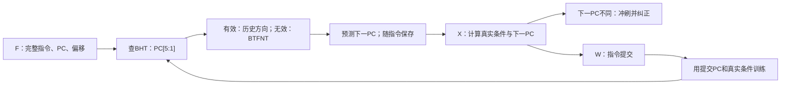
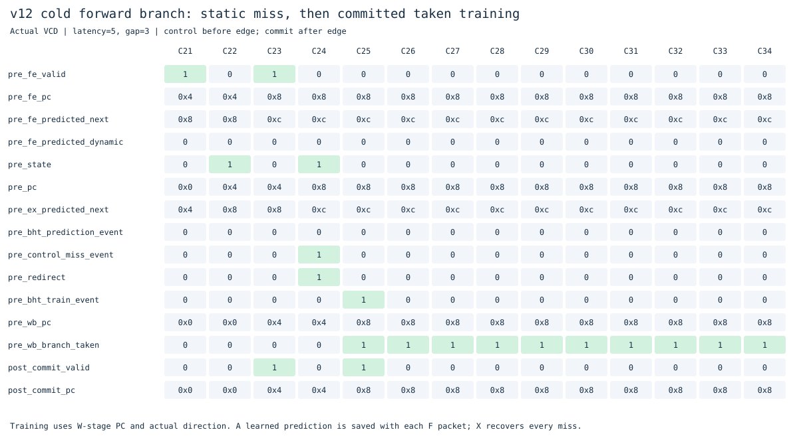
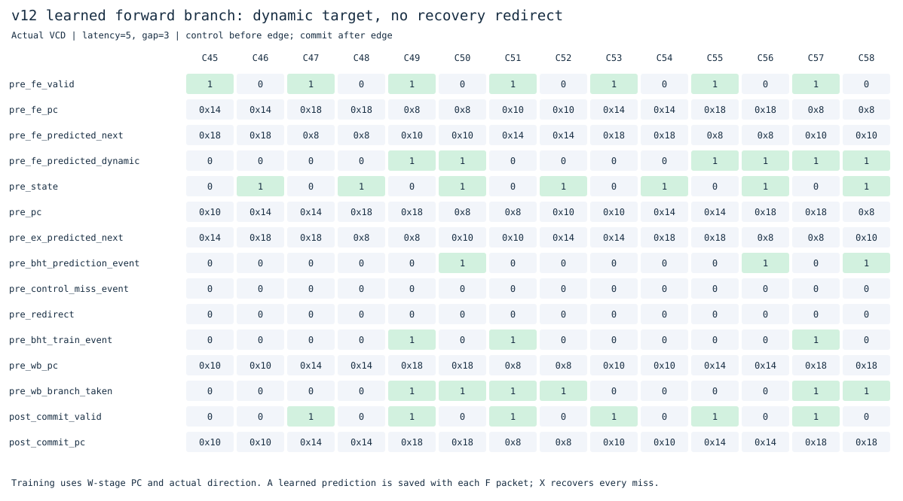

# v12：32项两位动态条件分支预测

v11解决了分页时重复读页表的问题。这一版处理另一种浪费：分支的实际方向长期稳定，但与BTFNT静态规则相反，每次都冲刷取指。例如向前跳过一个常见路径的条件分支，v11总预测不跳。

v12继承完整的F/X/W单发射、I/D缓存与TLB、RAS及RV64IMAC/特权功能。在新的独立目录中加入BHT；v11及更早版本的实现保持冻结。

## 怎样预测，怎样学习

取到完整指令后，F级已经知道PC、长度和分支偏移，可以算出跳转目标。新增的`rv64_bht.sv`保存32项历史，使用`PC[5:1]`索引，适配2字节对齐的压缩指令。每项有1位valid和2位饱和计数器，共96位逻辑状态，不含组合选择逻辑。

| 计数值 | 含义 | 下次预测 |
|---|---|---|
| 0 | 强不跳 | 不跳 |
| 1 | 弱不跳 | 不跳 |
| 2 | 弱跳转 | 跳转 |
| 3 | 强跳转 | 跳转 |

有效项取最高位作为方向；实际跳转使计数加1，不跳使计数减1，边界饱和。无效项继续使用v9的BTFNT：向后跳、向前不跳。第一次提交训练将表项设为弱实际方向，之后按饱和规则学习。

这是**无标签表**：PC高位不同、低5位半字索引相同的分支会共享历史。valid仅表示这个索引训练过，不表示当前PC独占表项。这样结构简单，但可能相互干扰，下面保留了退步实验。



译码器导出真实`branch_taken`，X完成时将它与PC送入W。只有成功提交的条件分支才训练，因此错误路径、异常指令不会更新历史。不能通过`实际next_pc != pc+长度`推断真实条件：`beq x0,x0,+4`实际跳转，但目标刚好等于下一条32位指令地址；测试单独检查了这个例子。

F把预测地址和是否使用动态历史一起锁存；即使等待发射时BHT被更新，已经生成的指令包也保持原预测。X仍核对该指令自己的预测地址，失误时使用原有冲刷/排空机制恢复。F不在取到指令字节前预测，当前没有BTB、全局历史或投机历史回滚。

BHT仅覆盖合法、目标对齐的条件分支。JAL沿用静态目标预测，常见ret沿用RAS。异常/中断入口以及串行指令提交时保守清空历史；同周期清空优先于训练。训练写入后从下一周期可见，没有提交到查询的组合旁路。

## 本轮结果

实验编号`20261101T134644916779Z`。两版执行相同二进制，每次都逐条核对提交和最终64KiB RAM。下面均为外部延迟5、请求间隔3，单位为周期。

| 程序 | v11静态 | v12动态 | 条件分支预测失误：v11→v12 |
|---|---:|---:|---:|
| 向前恒跳 | 719 | 591 | 65→2 |
| 先不跳、后跳 | 851 | 791 | 33→3 |
| 交替跳/不跳 | 851 | 915 | 33→64 |
| 两分支共用索引、方向相反 | 479 | 547 | 33→65 |
| 求和 | 983 | 983 | 1→1 |
| 函数调用 | 343 | 343 | 1→1 |
| 分页循环 | 1131 | 1131 | 1→1 |
| 裸机C | 943 | 943 | 2→3 |

向前恒跳总周期减少17.80%，不是所有程序都更快。两位计数器能学习稳定偏向，并容忍偶发反向；交替模式可能让状态在弱跳/弱不跳间摆动，反复猜错。共用索引的相反方向也会互相破坏历史。

原有12个程序的36组条件中，35组总周期相同；裸机C在延迟1/间隔0时429→430周期。该C程序三种条件均多一次条件预测失误，另外两组被其他等待掩盖，不能只看总周期判断预测是否改善。原有程序的外部请求数均不变。

`BHT_ENABLE=0`的48组周期、请求数和控制失误与v11完全一致，确认本轮差异来自新增历史预测。所有其他功能开关也保留，公共比较共核对96次主实验和912次功能关闭实验。

遵循本轮暂不分析时序的方向，使用`--cycles-only`，CSV中的周期时间、估计总时间、面积字段留空。本轮没有进行标准单元门级仿真或STA，不从周期减少推断真实芯片频率或耗时。

[跨版本比较](../../results/comparisons/20261101T134644916779Z/comparison.csv) · [BHT开关对照](results/20261101T134644916779Z/bht-ablation.csv) · [独立方向/压缩指令实验](results/20261101T134644916779Z/bht-directed-ablation.csv)

## 看真实波形

以下为Verilator VCD的时钟沿采样图，控制信号取沿前、commit取沿后。C编号表示仿真周期，与物理频率无关。



PC=0x8是向前条件分支。C24在X发现静态预测0xc错误，实际应到0x10，于是`control_miss_event=1`、`redirect=1`。C25在W提交这个分支，`bht_train_event=1`、`wb_pc=0x8`、`wb_branch_taken=1`，将无效项初始化为弱跳转。图中valid为0的PC/数据是保留值，不表示又执行了一条指令。



C49的F指令包PC=0x8，`fe_predicted_dynamic=1`，预测下一PC已是0x10。C50该分支在X核对，`bht_prediction_event=1`且`control_miss_event=0`，无需冲刷；C51才在W提交并进一步训练。预测、执行核对、提交训练是三个不同动作。

## 验证与复现

在仓库根目录：

```sh
make check
make lint
make test
make test-bht
make diagrams
python3 tools/benchmark.py --versions v11_tlb v12_dynamic_predict --cycles-only
```

- BHT开启/关闭模型各20,354步，覆盖饱和、滞回、半字索引、高位别名、清空优先级和随机查询/训练。
- 新增45次整核回归、9,280条提交，覆盖稳定方向、阶段变化、交替、索引冲突、压缩分支、错误路径、串行清空和目标等于顺序地址；另有36次动态/静态对照。
- 全部原有ISA、特权、缓存、总线、预测与TLB测试保留；合计506次原生整核回归、41,918条提交。基础RV64I/ALU/71次程序实验另外核对。
- `make synth`检查可综合性和结构；本轮不进行映射时序分析。验证范围及哈希见[验证记录](results/20261101T134644916779Z/validation.json)。

核心变更在`rtl/rv64_bht.sv`、`rv64_fetch.sv`、`rv64_decoder.sv`、`rv64_core.sv`；宿主只统计事件，不代替硬件训练。旧版翻译/cache设计解释见[v11](../v11_tlb/README.md)，返回预测见[v10](../v10_return_stack/README.md)。

下一步适合研究带历史的预测器或改善表项冲突，并继续用当前退步案例检验；BTB则解决必须等到指令完整后才能预测的问题，属于另一个前端优化方向。
