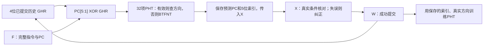
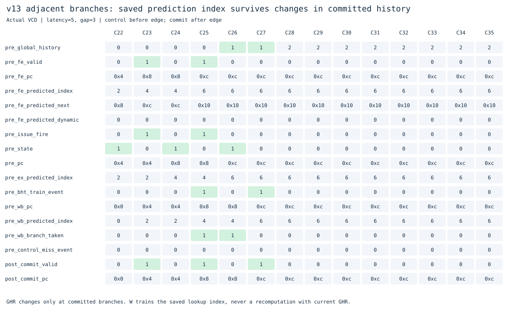
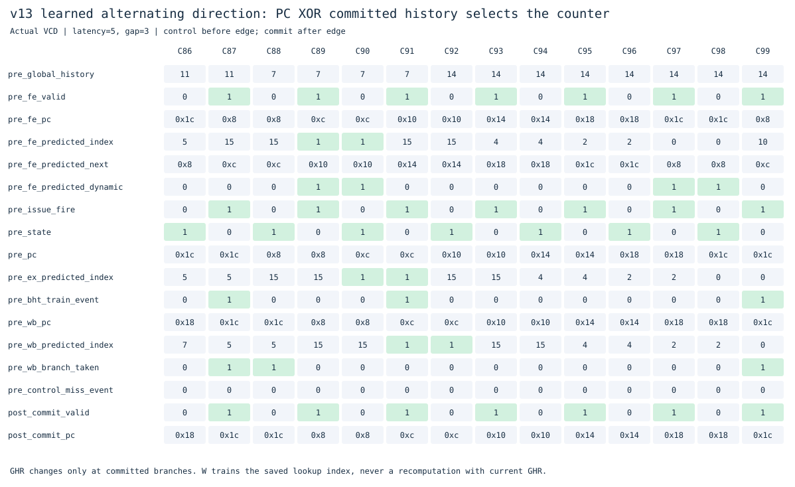

# v13：带4位提交历史的gshare分支预测

v12的两位计数器能学习稳定方向，但交替分支与共用索引的相反方向会反复猜错。v13继续使用32项计数器，加入最近分支方向，让同一PC在不同历史下可以选择不同计数器，单独比较历史索引的效果。

本版本保留F/X/W单发射、RV64IMAC、M/S/U、Sv39、I/D TLB与缓存、返回地址栈。v1–v12独立冻结，新版源码放在此目录。

## 硬件怎么工作

保留`rv64_bht.sv`模块，通过`GSHARE_ENABLE`选择gshare或原bimodal模式。计数器表也称PHT（Pattern History Table）。

```text
GHR：最近4次已提交条件分支的真实方向，1表示跳转，0表示不跳
查询索引 = PC[5:1] XOR {1'b0, GHR}
预测方向 = 有效表项的两位计数器最高位
```

仍是32项，每项valid加两位饱和计数器。无效索引回退BTFNT，首次训练初始化为弱实际方向；有效项按真实方向饱和加减。表项无PC标签，仍然可能发生冲突，gshare不会保证消除所有干扰。

只统计条件分支历史，JAL与JALR不移入GHR；JAL目标预测和RAS继续沿用原设计。压缩分支在展开后使用相同逻辑，索引按半字地址计算。



### 为什么必须保存索引

从F查询到W提交期间，其他分支可能已经提交，使GHR改变。假设PC=0xc，在F查询时GHR=0，选中索引6；提交时GHR变为1，重新计算会得到7。此时必须更新原来的6，才能训练当时真正用于预测的表项。

因此F注册`predicted_index`，X保存`ex_predicted_index`，W保存`wb_predicted_index`。**无论查询命中还是冷启动，都保存索引**，否则第一次分配也可能写错位置。指令包被背压暂停时，索引、预测地址和动态预测标记均保持不变。

这版不维护投机GHR：只有成功提交的条件分支才更新PHT和移入真实方向。错误路径不会训练，不需要历史回滚；代价是紧邻分支查询时，历史可能还没有包含前面的未提交分支。提交训练与F注册发生在同一时钟沿时，F使用沿前状态，没有组合旁路。

复位、异常/中断入口、串行指令提交会清空GHR和PHT有效位，清空优先于同周期训练。X仍核对指令自己的预测下一PC并恢复错误路径，预测逻辑不会改变程序语义。

计数表的96位逻辑状态不变，新增4位GHR，以及F/X/W各5位查询索引寄存器。没有测量本版标准单元面积或物理时序，不能将这19位直接等同于总硬件代价。

## 实测改善和退步

实验编号`20261101T155101234625Z`。v12/v13运行17个相同二进制，在三种内存条件下比较。下面均为外部延迟5、请求间隔3，单位为周期；预测失误指条件分支实际下一PC与保存预测不同的次数。

| 程序 | v12 bimodal | v13 gshare | 条件分支失误：v12→v13 |
|---|---:|---:|---:|
| 交替方向 | 915 | 791 | 64→3 |
| 共用PC索引的相反方向 | 547 | 423 | 65→4 |
| 相邻相关分支 | 1115 | 871 | 129→7 |
| 向前恒跳 | 591 | 595 | 2→4 |
| 方向分阶段变化 | 791 | 795 | 3→4 |
| 求和 | 983 | 983 | 1→1 |
| 函数调用 | 343 | 343 | 1→1 |
| 分页循环 | 1131 | 1131 | 1→1 |

交替案例减少124周期（13.55%），相关分支减少244周期（21.88%）。全局历史让部分原来混在同一计数器里的模式分开，改善了这些特定程序。恒跳与阶段变化反而增加4周期：历史变化会选择不同表项，带来不同的冷启动和表项干扰。不能据此宣称gshare对所有分支更好。

原有12个非`branch_*`程序、36组条件的周期与请求数均保持一致。本轮比较102次主实验、1071次功能关闭实验；`GSHARE_ENABLE=0`的51组周期、请求和控制失误与v12完全一致，确认差异来自新增历史预测。关闭gshare仍保留BHT，其结果不能称为关闭全部预测。

| 开关 | 行为 |
|---|---|
| 默认开启 | gshare，32项计数器加4位提交历史 |
| `GSHARE_ENABLE=0` | 恢复v12的PC索引bimodal预测 |
| `BHT_ENABLE=0` | 关闭动态条件预测，保留BTFNT、JAL与RAS |
| `PREDICT_ENABLE=0` | 关闭条件/JAL/RAS预测，沿用顺序取指与X纠正 |

遵循暂不分析时序的方向，本轮使用`--cycles-only`，周期时间、估计耗时和面积字段留空。运行了Yosys可综合性/结构检查，没有进行标准单元门级仿真或STA。

[跨版本比较](../../results/comparisons/20261101T155101234625Z/comparison.csv) · [gshare关闭对照](results/20261101T155101234625Z/gshare-ablation.csv) · [定向实验](results/20261101T155101234625Z/gshare-directed-ablation.csv)

## 实际波形中的索引与训练

图由Verilator真实VCD导出。控制信号取时钟沿前、commit取沿后；没有valid/event时显示的PC和索引只是寄存器保留值。



在相邻分支测试中，C25的F指令包PC=0xc，保存查询索引6；同一个沿前，W提交PC=0x8的已跳转分支，使下一周期GHR变成1。到了C27，PC=0xc提交，`wb_predicted_index`仍为6。此时用当前GHR重新计算会得到7，硬件使用保存的6，随后按真实不跳更新GHR为2（低四位0010）。

这不是假设的边界：整核VCD审计在相邻普通分支中找到125次、相邻压缩分支中找到62次“保存索引与提交时重算索引不同”，均核对实际训练使用保存索引。



交替测试中，PC=0xc的条件分支在不同GHR下查询不同表项。图中的动态预测标记表示使用了有效历史；X核对时`control_miss_event=0`，随后在W才更新对应表项和GHR。

## 验证与复现

仓库根目录：

```sh
make check
make lint
make test
make test-gshare
make diagrams
python3 tools/benchmark.py --versions v12_dynamic_predict v13_gshare --cycles-only
```

- 模型测试分别运行gshare、关闭动态预测、bimodal三种配置，各30,362步；覆盖全部索引、饱和、滞回、历史变化、清空优先级、保存索引训练和随机输入。
- 前端39项检查覆盖内存/指令输出背压、历史更新期间的指令包稳定性、半字索引与清空。
- 新增30次整核回归、6,705条提交，覆盖交替、相关、相邻、压缩、串行清空；另有36次gshare/bimodal定向对照。
- 整核VCD审计独立维护GHR和计数器表，核对新F包查询索引、预测地址、发射到提交的索引传递、训练效果与清空。既验证命中项，也验证冷索引分配。
- 旧测试全部保留：合计536次原生整核回归、48,623条提交；基础71次程序、ALU与RV64I实验另行核对。

[验证记录](results/20261101T155101234625Z/validation.json)保存范围和哈希，[索引审计](results/20261101T155101234625Z/gshare-index-audit.json)保存上述真实差异次数。旧实验不覆盖。

核心实现见`rtl/rv64_bht.sv`、`rv64_fetch.sv`和`rv64_core.sv`；测试见`scripts/gshare_tests.py`、`sim/bht_test.cpp`、`sim/gshare_fetch_test.cpp`。

这一版回答“加入历史能否帮助识别模式”。后续可研究BTB提前产生目标，或者投机历史与恢复以缩短历史滞后；两者分别需要独立版本和新的验证。
