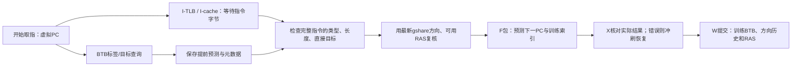
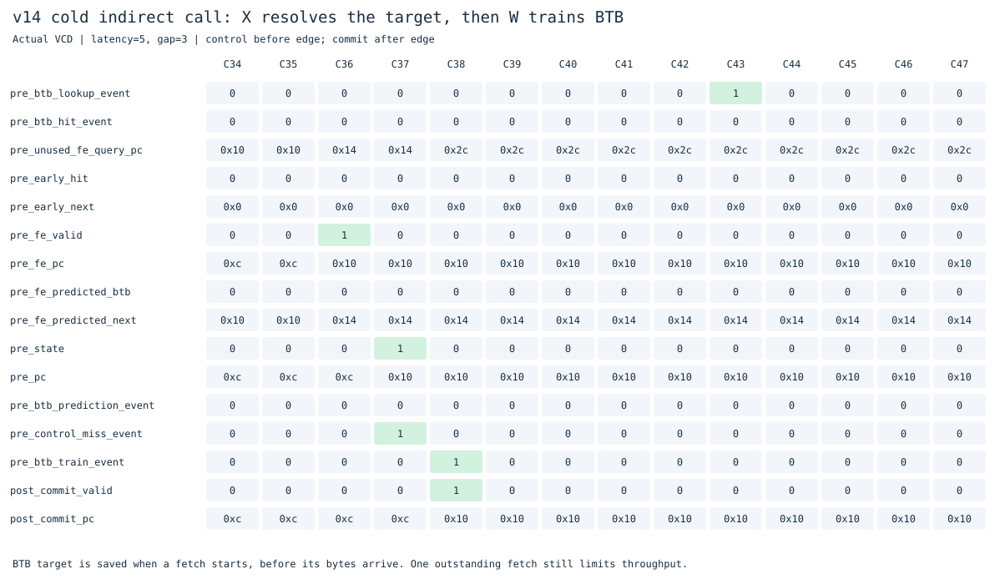
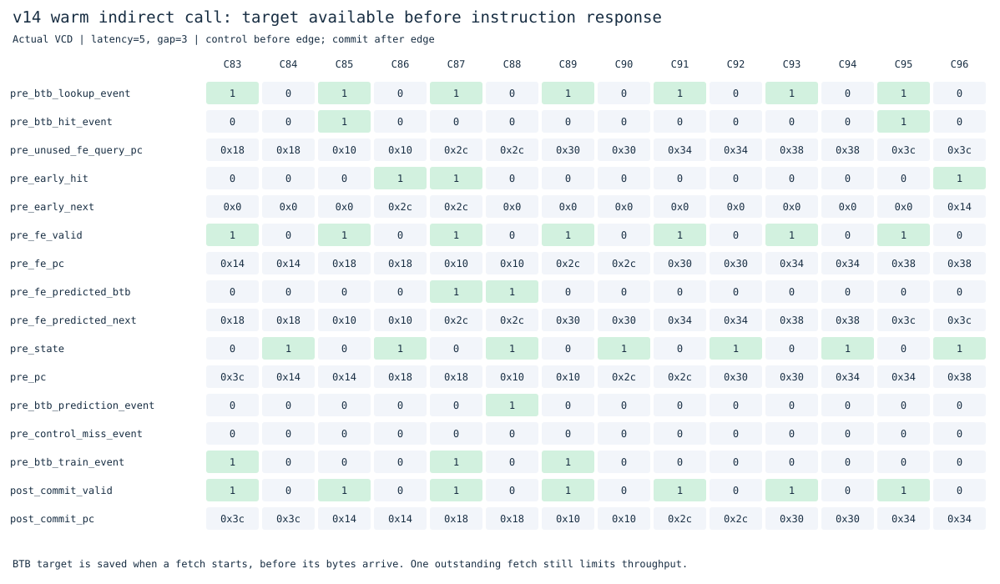

# v14：请求时查询的32项BTB

v13学习条件分支方向，但普通间接调用仍要等X算出寄存器目标。v14增加BTB（Branch Target Buffer）：缓存某个虚拟PC的控制流类型、目标、指令长度，在开始取指时就查出预测目标。新版放在独立目录，v1–v13冻结。

仍为单发射F/X/W，继承RV64IMAC、M/S/U、Sv39、I/D TLB与缓存、gshare和RAS。

## 目标和方向分开

| 结构 | 回答什么问题 |
|---|---|
| BTB | 当前PC是否曾是控制流指令，目标在哪里、指令多长？ |
| gshare | 条件分支更可能跳转还是不跳转？ |
| RAS | 常见函数返回地址在哪里？ |
| X执行级 | 真正的方向与目标是什么，是否需要纠正？ |

`rv64_btb.sv`使用32项直接映射，索引为`PC[5:1]`，标签为完整高位`PC[63:6]`，要求半字对齐，因此支持压缩指令，并能区分相差64字节或高位不同的虚拟PC。每项保存valid、标签、64位目标、控制类型、2/4字节长度和条件偏移符号。无ASID标签，采用保守上下文清空策略。

成功提交的控制流才分配/更新：

- 条件分支保存`PC+B立即数`，即使这次不跳，也保存跳转目标，不能把实际顺序下一PC当目标。
- JAL保存`PC+J立即数`。
- JALR保存上次实际跳转目标，常见ret另标类型，优先结合RAS预测。

复位、异常/中断入口及串行指令提交会清空BTB，包含FENCE.I、SFENCE.VMA、satp相关操作和特权返回；清空优先于训练。没有在错误路径训练，也没有把宿主软件查表当作硬件实现。

## 提前查询与返回后复核



普通取指请求被接受时锁存BTB命中、类型、目标、长度和提前预测；半字复用开始新指令时也查询，跨字32位指令只在开始时查询一次。BTB目标仍是虚拟地址，后续取指仍通过I-TLB和I-cache，不能跳过权限检查。接受请求后，即使表项被其他提交更新，当前查询快照仍保持不变。

字节返回后验证控制类型、指令长度和直接分支/JAL目标。旧表项覆盖普通指令、长度改变或直接目标改变时，拒绝该快照并使用原有完整指令预测。这个拒绝不等同于立即删除表项，后续提交训练或串行清空会更新它。间接目标依赖寄存器，最终由X核对，变化时使用原有错误路径排空机制恢复。

**条件方向在字节返回时刷新。** 提前查询会看到较旧的提交历史，如果一直锁定该方向，某些交替/冲突案例会退步。当前阻塞接口还没发出后继请求，因此可以使用最新gshare方向与其查询索引，再生成稳定F包；ret也用当前可用RAS复核。提前预测与最终F包预测是两个时间点，不能混用它们的历史索引。

这一版没有新增取指队列或多笔在途请求。目标提前可用，但外部取指仍须等待当前指令响应、组装与下游接收。因此不会仅因BTB命中就自动省一拍。对直接JAL/循环，v13已经能在返回字节当周期组合算出目标，BTB未增加它们的请求吞吐；新增收益主要来自稳定间接目标的预测。

## 实测结果

实验编号`20261101T161823965110Z`（UTC，上海时间11月2日）。两版执行相同二进制，逐条提交与完整RAM均通过独立参考模型。下面为外部延迟5、请求间隔3，单位为周期。

| 程序 | v13 | v14 | 控制预测失误：v13→v14 |
|---|---:|---:|---:|
| 新增重复间接调用 | 379 | 351 | 17→2 |
| 普通直接调用 | 343 | 343 | 1→1 |
| 求和 | 983 | 983 | 1→1 |
| 分页循环 | 1131 | 1131 | 1→1 |
| 交替方向 | 791 | 791 | 3→3 |
| gshare索引冲突 | 423 | 423 | 4→4 |

间接调用的目标失误16→1，总周期减少7.39%；另一次失误是循环退出。低延迟该程序323→293周期。原有17个程序、51组条件的周期、外部请求与控制失误均保持一致。

定向测试还保留适用范围：

| 目标模式 | BTB关闭→开启周期（延迟5/间隔3） | 结论 |
|---|---:|---|
| 两个目标分阶段切换 | 635→575 | 每个阶段可学习，但切换会失误 |
| 两个目标逐次交替 | 811→811 | 上次目标预测无法识别交替 |
| 两个间接调用竞争同一BTB槽 | 479→479 | 带标签能避免误命中，不能避免替换 |
| 修改函数后FENCE.I | 631→575 | 验证清空与重新学习，结果正确 |

公共比较108次主实验、1242次功能关闭对照；`BTB_ENABLE=0`的54组周期、请求和控制失误均与v13相同。其他功能开关仍保留BTB，不能把它们当作没有BTB的历史架构。

本轮使用`--cycles-only`，暂不测标准单元面积或STA，也没有进行门级仿真。表项和快照有存储/比较成本，周期下降不直接等于芯片实际耗时下降。

[跨版本CSV](../../results/comparisons/20261101T161823965110Z/comparison.csv) · [BTB关闭对照](results/20261101T161823965110Z/btb-ablation.csv) · [定向实验](results/20261101T161823965110Z/btb-directed-ablation.csv)

## 真实波形

图由Verilator VCD导出，控制取沿前、commit取沿后。没有对应valid/event时，PC和目标只是寄存器保留值。



PC=0x10的JALR第一次没有BTB记录，按顺序取指，X算出实际目标0x2c后纠正。到W成功提交时，才将该目标写入BTB。



C85开始取PC=0x10，`btb_lookup_event`与`btb_hit_event`为1。C86的提前快照已有`early_next=0x2c`，这个PC的完整F指令包此时尚未产生。C87形成F包，`fe_predicted_btb=1`、预测下一PC为0x2c；C88在X核对，无控制预测失误，随后W提交再训练。

该基准的独立BTB波形模型核对139次查询、46次命中；46次命中均发生在被查询指令的完整包产生前。模型按提交记录维护标签和目标，并核对快照类型、长度、目标与历史索引，见[查询审计](results/20261101T161823965110Z/btb-query-audit.json)。

## 验证与复现

在仓库根目录：

```sh
make check
make lint
make test
make test-btb
make diagrams
python3 tools/benchmark.py --versions v13_gshare v14_btb --cycles-only
```

- BTB开启/关闭模型各25,578步，覆盖全部槽位、高位标签、替换、各控制类型、目标立即数、长度与清空优先级。
- 前端21项检查覆盖背压、旧直接目标、旧控制类型、旧长度、清空以及等待响应期间方向改变后的索引/方向刷新。
- 新增30次整核回归、5,800条提交，覆盖稳定/变化/阶段间接调用、压缩调用、冲突、修改代码与FENCE.I；另有36次定向开关对照。
- 原有全部回归保留，合计566次原生整核仿真、54,423条提交；基础71次程序实验、ALU和RV64I测试另行运行。
- gshare审计区分请求时查询与完整指令时重新预测，继续检查索引从F到W的传递与真实提交训练。Yosys可综合性/结构检查通过。

[验证记录](results/20261101T161823965110Z/validation.json)保存验证范围、源码及实验哈希；旧实验不覆盖。

## 接下来按什么顺序推进

1. **前端解耦与2–4项取指队列**：让X等待load/muldiv时，F还能积累指令；先保持单笔在途请求，验证背压、队列占满和分支清空。
2. **I-cache/TLB命中路径流水化与多笔在途取指**：提高请求接受吞吐，用请求元数据、epoch或ID处理预测路径、返回响应与错误路径排空。到这一步，BTB提前目标才更有机会转化成前端吞吐收益；不能只增加队列而保持所有下游接口串行。
3. **按测量改善访存与发射宽度**：先定位下一瓶颈，再选择访存缓冲或双发射。必须先明确访存顺序、精确异常、前递及资源冲突，之后再考虑重命名/ROB的乱序执行。

多核放在后面，需要可并行的软件和缓存一致性设计；增加核数不会自动加速当前单线程基准。每一阶段继续独立版本目录、功能开关、逐条参考校验和README记录。
