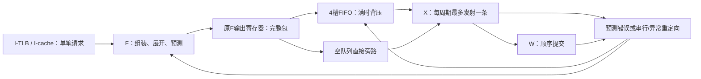
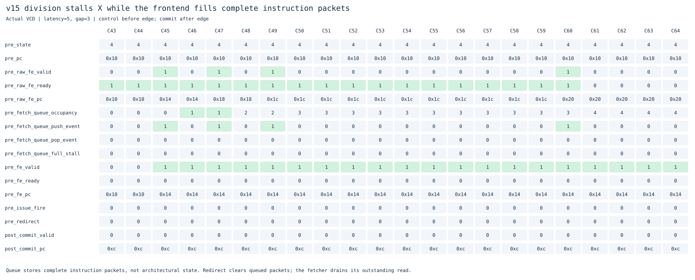
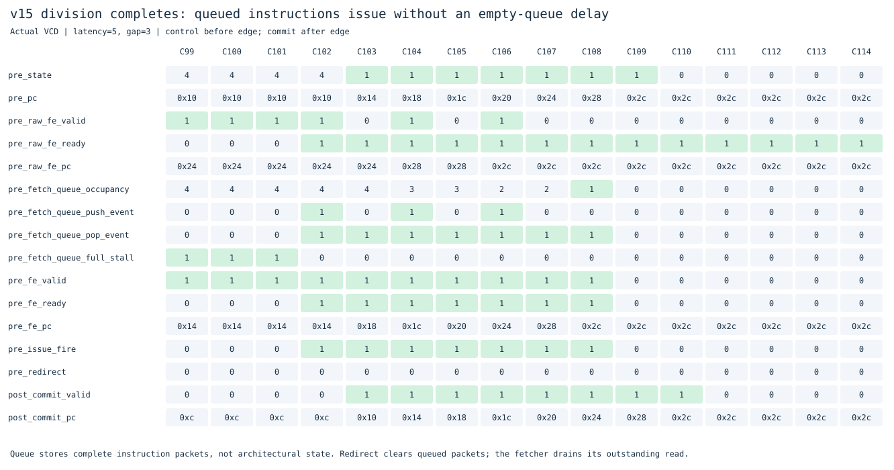
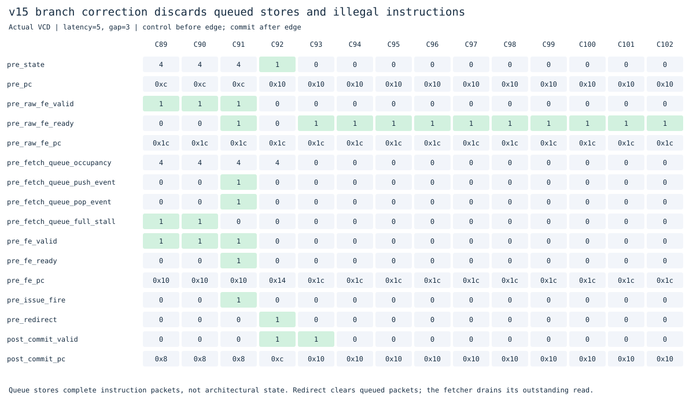

# v15：四项取指队列与前端解耦

本版本在提交`f0532aa`后冻结，当前开发见[v17多笔取指](../v17_fetch_window/README.md)，中间阶段见[v16](../v16_ifetch_pipeline/README.md)。

v14已经可以提前预测目标，但X等待load或乘除法时，F只有一个完整指令寄存器，很快随之停取指。v15在完整指令组装与X发射之间加入4项FIFO，缓冲这段时间取得的指令，X恢复后可直接消费。

新版独立放在本目录，v1–v14冻结。继承RV64IMAC、M/S/U、Sv39、I/D TLB与cache、gshare及BTB/RAS；仍是F/X/W单发射、顺序执行与提交，仍最多一笔在途取指。这一版没有增加发射宽度，也没有让其他指令越过等待中的load/div去执行。

## 队列保存什么

`rv64_fetch_queue.sv`保存4个完整的333位包。字段成组入队、出队，避免PC、异常或训练索引错配。

| 字段 | 位数 | 用途 |
|---|---:|---|
| PC、预测下一PC、异常cause、异常value | 4×64 | 执行地址、预测核对、精确异常 |
| 展开指令、原始指令 | 2×32 | 执行与提交参考对照 |
| 指令长度 | 3 | 压缩/普通指令的顺序PC |
| 非法、取指异常、RAS来源、动态方向来源、BTB来源 | 5 | 保留指令与预测属性 |
| 方向预测查询索引 | 5 | 提交时训练当时查询的表项 |

四槽位的数据状态共1332位，另有2位读指针、2位写指针、3位占用计数。F原有输出寄存器仍保留，所以可能同时缓存**4个FIFO包加1个F输出包**；这不代表5笔在途取指。没有测量本版标准单元面积和时序，存储位数不等同于总硬件成本。



## 空、满和冲刷怎样处理

- **空队列旁路**：输入有完整指令、X可以接收时，同周期直接送X，不先入队再等待一拍；两个指针不必移动。
- **X暂停**：F的包先入FIFO，原输出寄存器腾出后，可以继续取下一条。
- **队列满**：若X同周期出队，仍允许F入队，读旧队首、写新队尾；否则向F输出背压。原F寄存器可继续保留一个完整包。
- **重定向优先**：分支纠正、异常/中断、FENCE.I等串行提交会清空FIFO并禁止同周期旧包传输。旧前端仍负责丢弃已接受错误路径请求的响应，不取消已接受事务。

X的发射、前递、异常判断与W提交规则沿用v14。排队指令只保存编码和元数据，寄存器操作数仍在真正发射时读取并前递。队列中的异常包也必须按顺序到达提交点才产生异常，错误路径上的异常包应随重定向丢弃。

CSR、特权返回和FENCE相关指令仍保持原有串行化屏障：年轻指令不能越过它执行，提交重定向清掉旧上下文的队列内容。I-TLB和cache的权限检查没有绕过，缓存缺失与总线仍可能阻塞取指。

## 预测历史为什么也要保留

排队期间，GHR、方向计数器、RAS或BTB可能已经被其他提交更新。已经生成的包不能据此偷偷改变预测下一PC或训练索引，否则后面已经沿旧预测取得的指令流会与它不一致。

因此队列完整保留预测地址、来源标记与5位索引。X核对这个包自己的预测，W训练保存的索引。这里仍是提交时更新的历史，没有投机GHR或投机RAS回滚；更深的前端可能增加历史滞后，不能假设队列一定提高预测准确率。

## 本轮性能

实验编号`20261102T012407315946Z`（UTC，上海时间11月2日）。v14/v15执行19个相同二进制，在三种内存条件下比较，所有提交与最终64KiB RAM由独立参考模型核对。下表为外部延迟5、请求间隔3，单位为周期。

| 程序 | v14 | v15 | 外部请求：v14→v15 |
|---|---:|---:|---:|
| 求和 | 983 | 855 | 73→73 |
| 除法后独立指令 | 515 | 463 | 16→16 |
| 重复数据读取 | 1239 | 1111 | 10→10 |
| 裸机C | 943 | 887 | 93→93 |
| 分页循环 | 1131 | 1059 | 31→32 |
| 直线ALU | 1623 | 1623 | 136→136 |
| 普通函数调用 | 343 | 343 | 10→10 |
| 位操作 | 199 | 207 | 21→22 |
| 压缩依赖链 | 427 | 431 | 36→37 |

求和总周期减少13.0%，除法基准减少10.1%。队列利用X等待期间准备指令，减少恢复执行时等前端供给的间隙。它不能减少除法本身的执行周期，也不会把单发射变为多发射；在前端原本就能及时供给、X也不阻塞的程序里，可能没有收益。

两项退步也保留：位操作增加8周期、压缩依赖链增加4周期，外部请求均多1笔。更积极的前端可增加退出前的投机取指尾部和共享端口争用；不能只凭队列深度推断总时间一定下降。表中分页基准周期减少但请求多1笔，同样应分别观察周期、架构结果和实际发出的请求。

公共比较114次主实验、1425次功能关闭对照。`FETCH_QUEUE_ENABLE=0`直接恢复旁路，57组周期、外部请求与控制预测失误均与v14完全一致；其他功能开关仍保留队列，不能拿它们强行匹配更早的无队列架构。

数据缓存提前重启的定向对照中，总请求数可能因投机取指尾部不同而变化，因此检查相同架构结果、相同D-cache补行工作和逐条参考结果，分别记录两侧总请求。独立cache单元测试继续检查协议与错误行为。

本轮使用`--cycles-only`，暂不分析物理时序/面积，也未进行标准单元门级仿真。[跨版本CSV](../../results/comparisons/20261102T012407315946Z/comparison.csv)、[队列关闭对照](results/20261102T012407315946Z/fetch-queue-ablation.csv)、[定向实验](results/20261102T012407315946Z/fetch-queue-directed-ablation.csv)保留结果。

## 看真实波形

`raw_fe_*`是原F输出，`fe_*`是FIFO/旁路送往X的指令包。控制信号取时钟沿前，commit取沿后；无valid/event时，PC只是保留值。



`state=4`表示X等待乘除法。PC=0x10的除法还没完成，F已开始把后续加法送入FIFO，`fetch_queue_push_event`与占用数上升。队列满后，`raw_fe_ready=0`，原F输出保持不变。



C102除法结果就绪，X可以接收队首PC=0x14。此时FIFO满，但允许出入同时发生，因此`pop_event=1`、`push_event=1`，占用数保持4。后续加法可以接连发射；队列逐步耗尽后，仍会重新受单笔取指吞吐限制。



错误分支测试在长除法后放置依赖结果的分支、错误路径store和非法指令。队列在等待期间填满；分支于C92纠正时清空4项，错误store没有改写内存，也没有产生错误路径非法指令异常。原前端还会排空已接受的错误路径响应。

## 验证与复现

仓库根目录：

```sh
make check
make lint
make test
make test-queue
make diagrams
python3 tools/benchmark.py --versions v14_btb v15_fetch_queue --cycles-only
```

- FIFO开启/关闭模型各30,381步，随机核对完整333位包、空队列旁路、背压、绕回、满时同时出入、清空优先级。开启模式覆盖1512次满队列出入交换、60次满队列清空。
- 新增30次整核回归、1,515条提交、5次软件处理的精确异常，覆盖除法、load、混合压缩指令、依赖分支、错误路径store/非法指令、精确异常和FENCE.I；另有36次开关对照。
- 独立VCD模型逐拍维护FIFO并比较所有字段，检查入队/出队、满队列交换、非空重定向清空；同时跟踪每笔逻辑取指请求及响应，始终不超过一笔在途请求。
- gshare与BTB模型区分原F包生成和队列后的发射，继续核对保存索引的提交训练。旧ISA、特权、中断、缓存、原子和翻译测试全部保留。
- 合计596次原生整核回归、55,941条提交；基础71次程序实验、ALU和RV64I另行核对。中断测试在新周期进度下提交条数略有变化，仍逐条核对且异常/中断结果正确。
- Verilator lint、Yosys可综合性及结构检查通过；没有运行本版门级仿真或STA。

[验证记录](results/20261102T012407315946Z/validation.json)保存范围和哈希，[FIFO/在途请求审计](results/20261102T012407315946Z/fetch-queue-audit.json)保存实际观察结果。历史结果不覆盖。

核心变化在`rtl/rv64_fetch_queue.sv`与`rv64_core.sv`，原`rv64_fetch.sv`保持v14逻辑；包在取指完成之后排队，跨字拼接、半字复用与错误响应排空仍由原F处理。

下一阶段适合提升I-cache/TLB命中通路吞吐，再逐步支持多笔在途取指。需要明确请求PC/预测元数据、返回顺序与重定向后的响应归属，不能只增加请求数量。访存缓冲、双发射和乱序留到这些基础稳定并重新定位瓶颈后。
