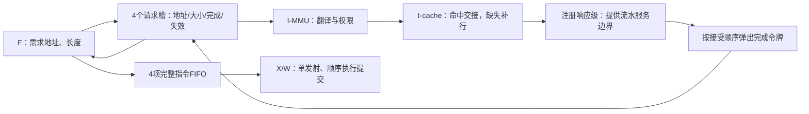
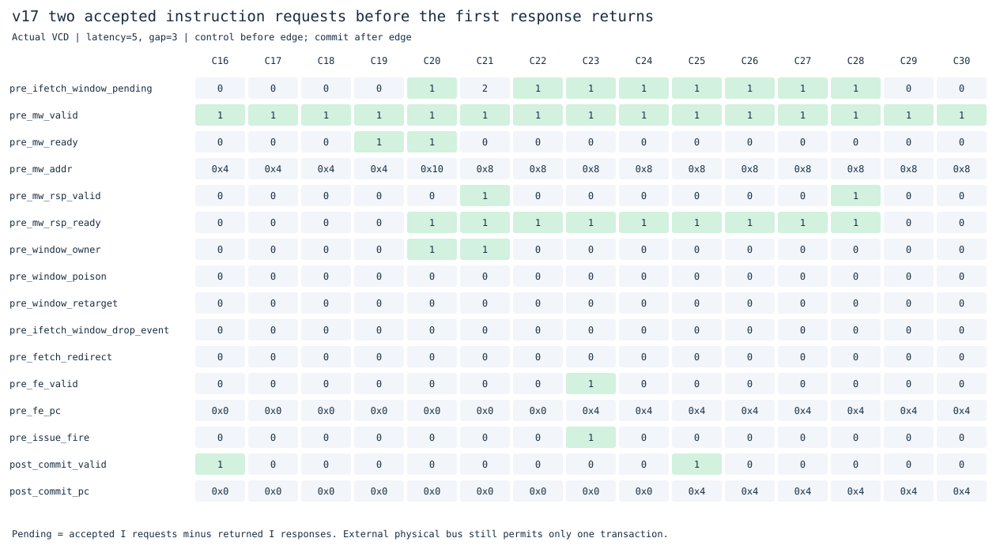
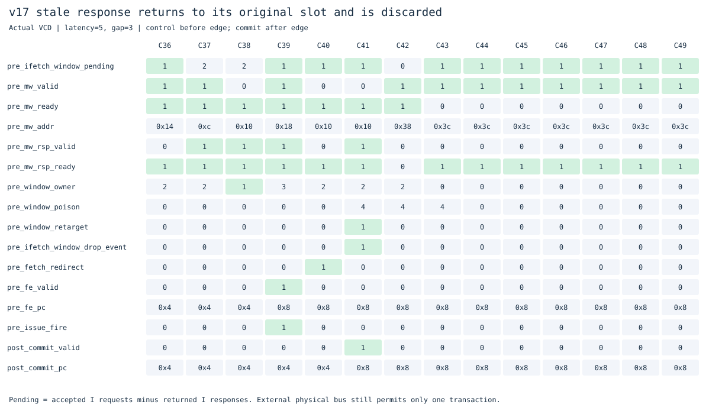

# v17：多笔在途的I侧请求窗口

本版接着[v16命中通路交接](../v16_ifetch_pipeline/README.md)，实现多笔在途取指，而不仅是保存已经取回的指令。保留[v15](../v15_fetch_queue/README.md)及v16独立目录，主分支直接保存每版实验。

**已在整核接口测到同时2笔已接受、尚未返回的I侧访问。** 请求窗口有4个槽位，带多周期服务的独立模型测到4笔峰值。外部物理总线仍单笔事务，页表遍历与I-cache缺失也仍阻塞；没有实现双MSHR、乱序内存响应或多核。

## 两个版本分别做了什么

| 版本 | 核心变化 | 在途范围 |
|---|---|---|
| v16 | I-cache旧响应与新请求同周期交接；合法ITLB命中直接转物理访问；F可在完整对齐32位指令返回周期请求后继 | 单笔逻辑取指，可连续交接 |
| v17 | 4个地址标记槽位、需求优先的顺序预取、I侧注册响应级、完成令牌与失效槽位 | 整核实际测到2笔I侧访问；模型覆盖4笔 |

v16仍检查canonical地址、执行权限、用户属性和A/D位，miss及大页使用原walker。数据侧MMU保持原实现。F输出满时必须反压响应，不能用新包覆盖旧包；串行、异常与中断准备接管时提前冲刷年轻取指并继续排空，防止“满队列等X、X又等总线”死锁。

## 请求窗口和指令队列不同

v15 FIFO保存完整、已展开和已预测的指令包。本版窗口保存尚未得到字节的读取请求，以及已经返回、但F还没消费的预取字。



需求优先，已有地址和大小匹配的预取槽可复用。普通对齐32位读取可向前预取，限制在同一个4KiB虚拟页内；2字节或不对齐需求按实际地址/大小读取，不用未经验证的整字结果替代。所有访问仍经过I-MMU权限检查和I-cache，没有绕过翻译或把虚拟地址当物理地址。

这是第一版保守顺序预取窗口，尚未用BTB连续驱动预取路径，也没有投机GHR/RAS。请求可按槽位优先级发出；返回按实际接受顺序匹配，不要求地址递增。

## 怎样确保响应不会串到新路径

每次I侧服务接口接受请求，就把槽位编号写入完成令牌FIFO。响应返回时只能交给队首令牌的原槽位。后续请求不能在这个响应返回之前复用该槽位。

分支重定向、FENCE.I、异常或地址预测改向时：

1. 未发出、或已完成但不再需要的旧预取可释放。
2. 已接受且未返回的槽位标为`poison`，保持令牌和所有权，继续接收旧响应。
3. 旧响应回来后丢弃，再释放槽位；新的请求不能提前覆盖旧槽的地址。
4. 原F若还在等被取消的需求，窗口给出专用取消完成，让F原有killed状态机排空；这个完成不作为新指令执行。

响应注册级不会因重定向清空，否则会丢掉已接受事务。串行操作提交和上下文切换要等待这些在途访问排空；已经完成的年轻指令与预取内容则由冲刷丢弃。槽位直到完成才复用，因此不用会绕回的小epoch计数器来猜旧响应归属。

## 多笔的测量边界

`mw_valid && mw_ready`表示I侧服务接受一笔请求，`mw_rsp_valid && mw_rsp_ready`表示它向窗口返回一笔响应；逐拍计数两者之差，而不是用队列占用或预取命中数替代在途数。

注册响应级属于I侧服务流水线：允许前一笔处于响应级时接受后一笔。整核流式程序在C19接受地址0x4，C20又接受0x10，C21才返回前一笔，故C20沿后有2笔在途。外部`req/rsp`另行计数，峰值始终为1。前者包含命中流水访问，不等同于两个外部内存缺失同时执行。



控制信号取沿前，commit取沿后；图中C21沿前`ifetch_window_pending=2`。这里显示的是接口事务计数，和完整指令FIFO占用不同。



示例中重定向后，槽位2被标失效（poison位图4）。响应仍返回槽位2，`ifetch_window_drop_event=1`，随后在途计数减少，没有把它当作新目标的指令。含跳转和FENCE.I的整核程序均检查了这一行为。

## 实测性能：多笔不保证全面更快

实验`20261102T020843568164Z`用三个版本执行相同19个二进制，在三种内存条件下逐条核对提交和完整RAM。下表为延迟5、请求间隔3，单位为周期。

| 程序 | v15 | v16 | v17 |
|---|---:|---:|---:|
| 直线ALU | 1623 | 1359 | 1375 |
| 分页循环 | 1059 | 735 | 791 |
| 求和 | 855 | 847 | 863 |
| 压缩依赖链 | 431 | 431 | 411 |
| 裸机C | 887 | 847 | 927 |
| 间接调用 | 351 | 223 | 383 |

v16解除命中通路交接气泡，直线ALU和分页循环受益。v17实现了真正的I侧多笔访问，压缩依赖链比v16减少20周期，但没有全面跑赢v16：增加的响应级延迟、小窗口容量、缺失路径仍阻塞，以及分支改向导致的顺序预取丢弃，都会抵消并行收益。尤其不能把“在途数变大”直接当作性能提升。

`I_PIPELINE=0`的v16恢复v15；`FETCH_WINDOW=0`的v17恢复v16，包括取消响应寄存级。各57组周期、请求、控制失误与父版本一致。公共实验共171次主运行和114次关闭功能对照，全部通过独立参考校验。本轮只测周期，没有做STA、标准单元面积或门级仿真。

[合并CSV](../../results/comparisons/20261102T020843568164Z/comparison.csv) · [v17开关对照](results/20261102T020843568164Z/feature-ablation.csv)

## 验证与复现

```sh
# 仓库根目录，默认v17
make lint
make test
make test-window
make test-ifetch
python3 tools/ifetch_experiments.py --cycles-only
# 波形已由窗口测试生成，在本版本目录导出采样图
cd versions/v17_fetch_window
python3 scripts/window_waveforms.py
```

窗口独立模型运行40,000周期，覆盖响应背压、随机改向、连续多次冲刷、错误响应、4KiB边界及槽位复用，实际峰值4。指令内存系统另以流水模式运行49项翻译/权限/缓存/错误检查。

新增整核测试15次、1,280条提交，覆盖热指令流、预测跳转与错误路径store、修改代码和FENCE.I；同时运行原有全套ISA、特权、中断、原子、缓存、翻译、预测与队列回归。最终611次原生整核运行、56,634条提交全部通过独立参考模型。基础71次程序、ALU和RV64I测试另外执行。v16也保留596次整核回归与84项流水前端检查。

三个窗口整核审计均观察到2笔I侧在途、1笔外部事务；分别丢弃32、62、5笔失效完成。逐拍审计验证槽位编号、原地址、返回顺序、数据/异常元数据与poison状态。验证范围和源码哈希见[记录](results/20261102T020843568164Z/validation.json)，原始统计见[窗口审计](results/20261102T020843568164Z/window-audit.json)。

到此已经完成本次“直到实现多笔”的目标。下一步应先让预取窗口更好地跟随预测控制流、减少改向和多余请求，再评估非阻塞缺失路径；当前仍不是多笔外部RAM事务、双发射或乱序执行。

本版已冻结；后续预测路径预取独立保存在[v18](../v18_btb_window/README.md)。
