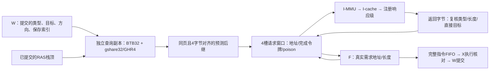
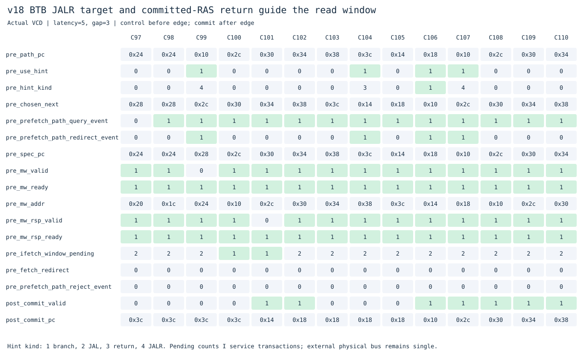

# v18：沿预测路径预取的请求窗口

本版保留[v17顺序窗口](../v17_fetch_window/README.md)，在独立目录实现BTB/gshare/RAS驱动的预取路径。仍是F/X/W单发射、顺序执行提交；四项完整指令FIFO与四个读取槽位是两种独立结构。

目的来自v17实验：顺序窗口在调用、返回和循环跳转后提前读取了很多不需要的字。只增加在途数量不能保证吞吐，必须让有限槽位尽量保存后面真正要执行的地址。

## 结构与关键设计



- **窗口独立查询。** F和窗口可能同时查询不同PC，因此增加一份BTB/BHT状态副本；两份表接收相同的W提交训练、保存索引和清空事件。没有投机训练、投机GHR或投机RAS；新增存储与组合逻辑的面积/时序成本本轮未测。
- **选择下一读取地址。** BTB未命中则`PC+4`；条件分支使用gshare方向，冷项回退向后跳、向前不跳；JAL/JALR使用BTB目标；常见ret优先使用已提交RAS栈顶。这个地址描述下一个读取字，并不取代F的逐条解码和下一指令PC。
- **保守覆盖范围。** 只从4字节对齐的读取起点查询，目标也须4字节对齐且处于同一4KiB虚拟页，否则退回顺序读取。压缩指令高半字起点暂不能直接驱动预测链；页边界外不继续预取。每笔读取照常经过MMU权限检查。
- **预测随槽保存。** 每个槽保存分配时的后继、类型、长度和目标。再次遇到已有槽使用其保存后继，不以较新的预测表结果重新连接旧链。
- **返回时复核。** 对返回字节展开压缩指令，核对类型、长度及B/J直接目标；不匹配、非法压缩或访问错误时停止进一步预取。已经发出的事务继续按令牌排空；需求读取、字节内容和故障传递保持原语义。JALR运行时目标和真实分支方向最终由X核对，错误预测正常重定向。

只在提交时训练比较容易保证精确状态，但前端跑在提交之前时，方向历史和RAS栈顶可能滞后。这是当前设计的性能限制之一。

## 请求与响应由谁发送

窗口向I侧服务发送`mw_valid / mw_addr / mw_size`，I侧服务发送`mw_ready`；沿上两者为1表示接受一笔读取。响应方向相反：I侧服务发送`mw_rsp_valid / data / error / cause`，窗口发送`mw_rsp_ready`。

每次接受时把槽号压入完成令牌FIFO；按接受顺序返回，响应只能归属原槽。重定向后已接受槽标为poison，旧响应回来丢弃后才释放，不能提前覆盖所有权。注册响应级也不能被冲刷掉，否则会丢失已接受事务。

**整核实测I侧服务接口峰值仍为2笔，独立模型覆盖4笔；外部物理总线仍单笔。** 这一版优化请求地址选择，没有增加cache缺失MSHR，也没有实现外部多事务或乱序响应。

## 实际波形



来自`path_calls.vcd`的真实采样，内存延迟5、间隔3；控制取沿前，提交取沿后。[逐拍CSV](docs/waveforms/path-target.csv)可查看原始数值。

C99查询PC=0x10，BTB识别JALR（kind=4），后继选0x2c；C100向服务发送0x10，C101发送0x2c。窗口先决定读取路径，发送还受槽位和握手控制，因此查询事件和请求接受不必发生在同一拍。C104的ret（PC=0x3c，kind=3）使用RAS给出0x14，后续服务请求沿该路径继续；无需先取无用的0x40。`commit_pc`记录已经提交的指令位置，其值并不是当前预取地址；只有`commit_valid=1`时形成提交事件。

## 周期实验与结论

实验[20261102T105547399149Z](../../results/comparisons/20261102T105547399149Z/comparison.csv)：v16/v17/v18执行相同19个二进制、三种内存条件，每版57组。171组主运行、171组功能关闭对照均逐条核对提交和完整RAM。v18关闭`PREFETCH_PATH`时57组周期、外部请求数、控制失误和提交数严格恢复v17。

下面是延迟5、请求间隔3的周期数，越小越好：

| 程序 | v16 | v17 | v18 |
|---|---:|---:|---:|
| 间接调用 | 223 | 383 | 251 |
| 调用/返回 | 227 | 367 | 235 |
| 裸机C | 847 | 927 | 923 |
| 分支别名冲突 | 367 | 495 | 499 |
| 顺序求和 | 847 | 863 | 863 |
| 直线ALU | 1359 | 1375 | 1375 |
| 分页循环 | 735 | 791 | 791 |
| 压缩依赖 | 431 | 411 | 411 |

相对v17，57组中24组改善、30组持平、3组退步；相对v16仅3组改善、54组退步。说明本版修复了顺序预取对调用路径的明显浪费，但窗口/响应级开销和前端吞吐仍需改进，不能把它称为全面更快的核心。

[新增定向程序开关对照](results/20261102T105547399149Z/path-ablation.csv)中，间接调用在延迟5/间隔3时383→251周期，poison响应97→7，而外部请求均12次。收益主要来自减少错误路径上的I侧访问与排空等待，并非减少外部内存读取次数。

## 验证与复现

```sh
make lint test
make test-path
make synth
make diagrams
# 从仓库根目录执行
make compare BENCHMARK_ARGS="--versions v16_ifetch_pipeline v17_fetch_window v18_btb_window --cycles-only"
```

全量回归保留指令、M/A/C、特权/异常/中断、Sv39/TLB、缓存、预测器、队列和窗口检查。新增：

- 独立BTB/PHT/GHR记分模型，启用/关闭各30481步，覆盖标签、别名、方向、RAS、对齐与页界。
- 24组窗口定向检查，覆盖目标、冷方向、跨页、陈旧类型/长度/直接目标和需求故障。
- 25次新增整核运行、4775次提交，另外30次开关对照；包括间接目标变化、交替分支、FENCE.I自修改和跳过非法/错误存储路径。
- 独立重放真实VCD上的提交训练、查询预测、槽内元数据及返回校验，并沿用所有权/poison与外部单笔审计。
- 原窗口随机模型40000周期，峰值4笔；整核观察到2笔I侧在途，外部事务峰值1。

[验证汇总](results/20261102T105547399149Z/validation.json)保存日志与源码哈希。Yosys综合及结构检查通过。本轮按当前学习安排不做STA、面积比较或门级仿真，周期收益不等于最终频率或运行时间收益。ISA支持范围及限制见[根README](../../README.md)。

## 下一步

优先解释v18相对v16剩余的周期损失：统计窗口命中但F无法及时消费、需求miss重定向排空、响应级额外等待和错误路径访问。以这些证据决定是否增加完成数据到F的交接/旁路、优化槽位回收；之后再考虑更复杂的投机历史或非阻塞cache。每个结构变化继续新建版本并保留关闭功能对照。
