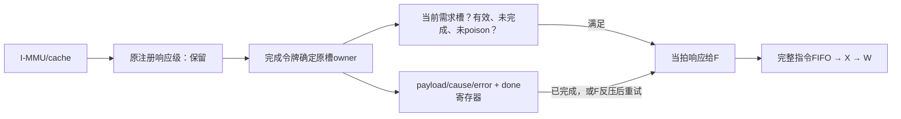
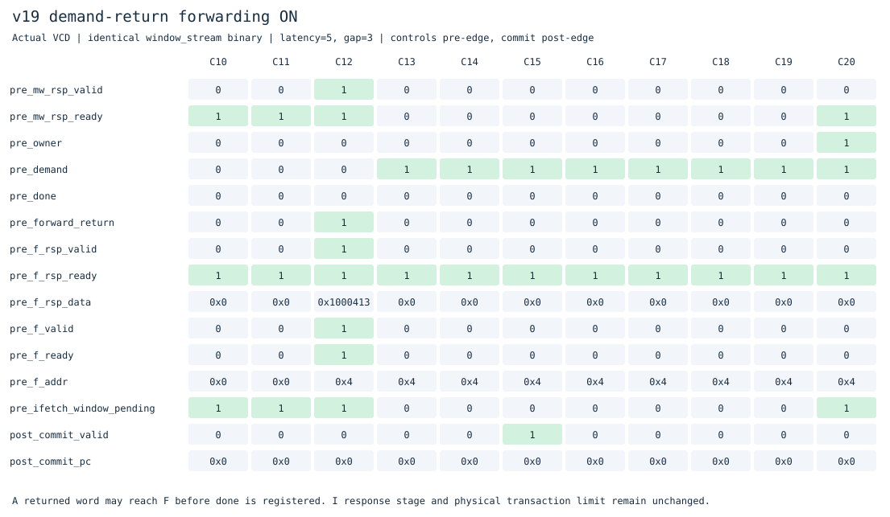
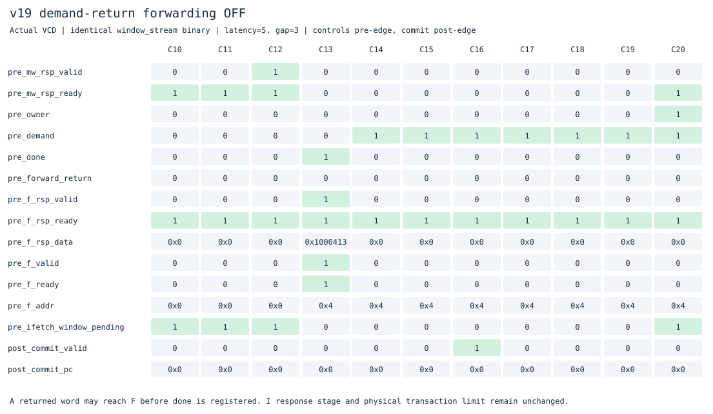

# v19：当前需求响应直接交给F

本版在独立目录接着[v18预测路径窗口](../v18_btb_window/README.md)，增加需求响应旁路，保留F/X/W单发射、顺序执行提交、四项指令FIFO和四个请求槽。v1–v18源码冻结，代码直接放在主分支。

## 为什么做这一步

先看真实波形，而不是继续增加预取数量。延迟5/请求间隔3时，v18的分支冲突程序有73次“当前需求数据已经到窗口，但F仍看不到响应”：返回先写`payload/done`，下一拍才送F。调用程序10次、裸机C60次、分页循环84次都有这种等待。

新增工具[`profile_ifetch.py`](../../tools/profile_ifetch.py)统计沿前状态，区分F等响应、X缺指令、需求返回及窗口额外等待。[三版采样记录](results/20261102T115217438473Z/forward-profile.json)保存v16/v18/v19的六个相同程序、相同内存条件结果。这些是重叠事件计数，不能相加当作总周期，也不能把每次旁路视为程序必然省一周期。

## 结构与控制



`WINDOW_FORWARD=1`时，满足下列条件就选择返回总线的数据、cause与error：当前有有效需求、需求槽尚未完成且未失效、I侧发生响应握手、令牌owner等于当前需求槽。数据、故障和有效位必须一起旁路，不能只提前`valid`。

F当拍接住时可同时发起预测后继需求；若没有接住，返回仍写入原槽，随后从已完成槽重试。因此不必把F的反压传回整个I侧流水线，也不会丢掉错误响应。

**原注册响应级保留。** 本版省掉的是“窗口再存一拍后才交给F”的等待。它没有增加cache缺失MSHR、外部多事务或乱序返回；整核I侧在途峰值仍2笔，独立窗口模型4笔，外部物理事务峰值仍1笔。

## 同拍交接与冲刷

- 返回仍由令牌FIFO按实际接受顺序确定owner，不能把其他预取槽的数据旁路给需求。
- 接收旧响应和接受下一需求可同拍发生；如果复用刚完成的槽，新请求的地址、大小和`done=0`必须覆盖旧完成状态。
- F暂时不接收时，槽位保存data/cause/error，直到接收或冲刷；接口不能在反压期间随意改数据。
- 已poison的旧响应继续丢弃。冲刷与当前响应同拍时，F按原redirect规则丢弃字节；不能因为新需求的retarget反过来撤销旧需求的当拍响应。

这条返回路径增加了组合选择，F也可能在当拍译码并算出后继地址。本轮没有做STA或面积测量，不能据周期数推断频率收益。

## 真实波形：同一个程序开关对照





两图均执行同一`window_stream.bin`，延迟5、请求间隔3；控制沿前采样，commit沿后采样。[开启CSV](docs/waveforms/forward-on.csv)、[关闭CSV](docs/waveforms/forward-off.csv)记录逐拍数值。

C12：`mw_rsp_valid=1`且owner=demand=0，返回字是`0x01000413`（`addi s0,zero,16`）。开启时尽管`done=0`，`forward_return=1`、`f_rsp_valid=1`，F接住响应并提出0x4的后继需求。关闭时C12没有F响应，直到C13的`done=1`才交给F；首条指令提交也从C16提前至C15。

数据先到F、再形成指令包、再进X/W，因此C12响应不等于C12提交。`commit_pc`只在`commit_valid=1`时表示本拍提交的那条指令。

## 性能结果与限制

[20261102T115217438473Z](../../results/comparisons/20261102T115217438473Z/comparison.csv)比较v16/v18/v19的19个相同二进制，三种内存条件，共171次主运行、171次关闭功能运行，逐条核对提交和完整RAM。

**v19关闭`WINDOW_FORWARD`后，57组周期、请求、控制失误及提交数严格恢复v18。** v18与v16本轮的各自关闭配置也运行独立参考校验；其父版本未选入本轮时，不宣称进行了父版本逐项对照。

延迟5、请求间隔3，周期越小越好：

| 程序 | v16 | v18 | v19 |
|---|---:|---:|---:|
| 重复数据读取 | 855 | 999 | 867 |
| 交替分支 | 443 | 559 | 487 |
| 压缩依赖 | 431 | 411 | 379 |
| 分支别名冲突 | 367 | 499 | 483 |
| 裸机C | 847 | 923 | 911 |
| 分页循环 | 735 | 791 | 787 |
| 调用/返回 | 227 | 235 | 231 |
| 间接调用 | 223 | 251 | 247 |
| 直线ALU | 1359 | 1375 | 1375 |
| 顺序求和 | 847 | 863 | 863 |
| 相关分支 | 483 | 559 | 563 |

相对v18，57组中49组改善、4组持平、4组退步。退步包括低延迟压缩依赖216→217，以及相关分支505→507、544→546、559→563。相关分支控制失误5→6、poison响应10→72，说明改变前端节拍也改变了预测查询和提交训练的交错；不能假设局部提前一定单调改善整机。

相对v16，仍只有3组更快、54组更慢。窗口的分配/发送、注册响应级、需求改向与旧事务排空成本尚未消除。

分支冲突的X缺指令周期239→196，压缩依赖192→158；直线ALU虽然所有136次需求返回都可当拍交给F，总周期仍1375。该指标说明局部额外等待被消除，但有些等待会被其他工作覆盖，整体还受缓存缺失、发送交接等因素限制。实际执行节拍也会改变多少请求先变成需求、多少先完成为预取，不能直接比较两版事件数来计算净收益。

## 验证与复现

```sh
make lint test
make test-forward
make synth
make diagrams
# 仓库根目录
make compare BENCHMARK_ARGS="--versions v16_ifetch_pipeline v18_btb_window v19_window_forward --cycles-only"
python3 tools/profile_ifetch.py versions/v19_window_forward/build/profile-c_demo.vcd
```

保留v18全量功能与独立参考校验，新增/更新：

- 旁路启用/关闭各17组定向测试：即时返回、反压1/7拍、暂停发请求、访问错误、同拍新需求、冲刷、poison。
- 窗口随机事务模型启用/关闭各40000周期，仍覆盖4笔峰值；请求/响应记分独立于RTL内部槽位实现。
- 五个整核VCD逐拍核对旁路条件、owner、data/cause/error、反压稳定、同拍后继需求，沿用旧响应所有权与外部单笔事务审计。流式样例165次返回旁路握手、163次同时接受后继；这些是传输计数，包含冲刷同拍被F丢弃的字节，不等于提交数。
- 原24组预测窗口定向驱动改为在设置内存输入后、时钟沿前采集握手，能够观察组合旁路响应；原数据与故障断言保留。
- 57组关闭优化恢复父版；Yosys综合和结构检查通过。

[验证汇总及哈希](results/20261102T115217438473Z/validation.json)记录实际运行数、参考提交数、源码、日志及trace/RAM摘要。原始VCD和完整构建日志保留在本地`build/`，SVG、CSV和精简报告入库。本轮未做STA、面积比较和门级仿真。ISA与特权功能范围见[根README](../../README.md)。

## 接下来

继续以v16为吞吐参照，区分冷缺失和热命中，测量需求分配后才发送的气泡，以及改向后的旧事务排空。下一版优先评估需求请求直接交接到I侧服务、减少需求miss的前置等待；需保持F同拍响应/请求不形成组合环，并继续验证槽位、令牌和上下文排空。

本版已冻结；后续新需求发送旁路独立保存在[v20](../v20_demand_issue/README.md)。
