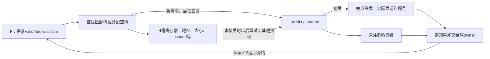
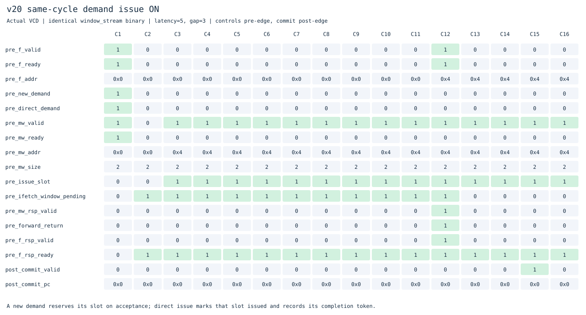
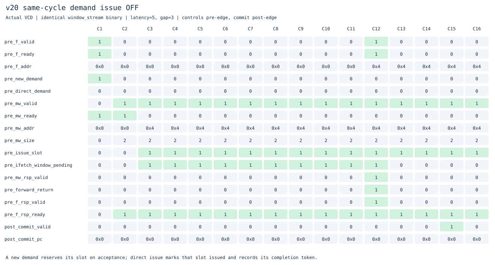

# v20：新需求请求当拍发送

本版在独立目录接着[v19需求响应旁路](../v19_window_forward/README.md)，缩短请求方向的交接。保留F/X/W单发射、顺序执行提交、四项完整指令FIFO和四槽读取窗口，v1–v19源码冻结。

## 为什么做这一步

v19缩短了返回数据到F的交接，但新需求仍先写入槽位，下一拍才能成为I侧请求。即使I侧当拍空闲，这一步也必须等。

本版让**槽位分配、I侧请求接受、完成令牌入队可以发生在同一时钟沿**。如果I侧暂时不能接收，逻辑需求仍可进入窗口；槽位保存地址和大小，之后按原规则重试。已经匹配到预取槽的需求沿用原路径，本版只旁路需要新分配槽的需求。

## 结构与关键控制



新增开关`DEMAND_ISSUE=1`。`direct_demand`表示F的新需求在窗口被接受且没有匹配槽；发送地址/大小直接取F输入，`issue_slot`取刚分配的空槽。普通预取和已经排队的需求仍由原`choose`选择。

必须同时做好三件事：

1. I侧真的接受时，把**实际发送槽号**写入令牌FIFO，并将新槽标为`issued=1`，避免下拍重复发送。
2. I侧未接受时，新槽保持`issued=0`，由寄存器保存的地址、大小重试；F不需要重新发同一需求。
3. 旧响应与新需求同拍时，先按旧令牌解释返回，再记录新请求；新分配槽的状态不能被旧完成覆盖。即使复用了刚完成的槽，令牌顺序也必须正确。

窗口的`u_ready`由本地槽位、当前需求和冲刷决定，不依赖下游`d_ready`；因此窗口可以缓冲背压。这里的两次握手含义不同：F↔窗口表示逻辑需求被接收，窗口↔I侧表示实际读取事务被接收，两者本版允许同拍，但不要求永远同拍。

**原注册响应级仍保留。** 它隔开I侧返回和新请求；F的返回旁路、当拍译码/后继、窗口直接发送都没有删掉这一级。Verilator lint和Yosys结构检查通过；本轮未做STA/面积测量，不能据此宣称频率改善。

## 如何处理旧路径与故障

需求改向时，已接受且未返回的旧槽继续poison，不能取消外部事务或提前复用其所有权。直接发送的新请求拥有自己的槽号，并排在旧令牌之后。旧响应回来只丢弃旧槽；之后返回的新需求字节与cause/error仍按原规则送F。

冲刷和暂停取指会阻止新需求的接受与发送。每笔请求照常通过MMU翻译和权限检查，没有物理地址捷径；异常、中断、FENCE.I、SFENCE.VMA和satp切换的排空规则沿用前版。

整核实测I侧服务接口峰值仍2笔，独立模型覆盖4笔，外部物理总线仍单笔。这个优化没有增加MSHR或外部并发事务。

## 实际波形：先确认交接，再看是否减少总周期





两图执行同一`window_stream.bin`，内存延迟5、请求间隔3，控制取沿前，提交取沿后。[开启CSV](docs/waveforms/issue-on.csv)、[关闭CSV](docs/waveforms/issue-off.csv)保留实际采样。

C1：F提出地址0，窗口接受。开启时`direct_demand=1`，同拍`mw_valid && mw_ready=1`；C2沿前的在途计数已经为1。关闭时C1只分配槽，到C2才发生I侧请求接受。

这个冷启动样例中，两版首笔I侧响应都在C12、首条指令都在C15提交。请求交接提前了，但后面的补行、共享物理总线及外部接受时刻覆盖了这一拍，因此不能声称每次直接发送都会让整机少一个周期。

## 完整周期对比

实验[20261102T140704313564Z](../../results/comparisons/20261102T140704313564Z/comparison.csv)用v16/v19/v20运行相同19个二进制、三种内存条件，共171次主运行和171次关闭功能运行，逐条核对提交与完整RAM。

**v20关闭`DEMAND_ISSUE`时，57组周期、外部请求、控制失误和提交数严格恢复v19。** 其他关闭配置也经过独立参考校验；父版本未选入本轮的配置不宣称进行了父版本逐项对照。

延迟5、请求间隔3，周期越小越好：

| 程序 | v16 | v19 | v20 |
|---|---:|---:|---:|
| 分页循环 | 735 | 787 | 763 |
| 顺序求和 | 847 | 863 | 855 |
| 裸机C | 847 | 911 | 907 |
| 重复数据读取 | 855 | 867 | 863 |
| 分支别名冲突 | 367 | 483 | 479 |
| 直线ALU | 1359 | 1375 | 1375 |
| 调用/返回 | 227 | 231 | 231 |
| 压缩依赖 | 431 | 379 | 379 |
| 向前分支 | 339 | 359 | 367 |
| 短访存 | 183 | 191 | 195 |

相对v19，57组中43组改善、10组持平、4组退步。退步是向前分支306→310、342→350、359→367，以及高延迟/背压短访存191→195。高延迟/背压向前分支控制失误保持4次，但外部请求9→10；短访存外部请求仍19次。局部交接提前会改变后续预取及总线竞争的交错，退步项保留，不宣称单调改善。

分支别名冲突虽然483→479周期，其控制失误却从5增到33次，poison响应182→125。预测查询和提交训练的相对时刻也随取指节拍改变，必须同时检查控制失误、无用读取和总周期，不能只挑一个指标。

相对v16仍只有3组更快、54组更慢。本版消除的是一类新需求发送气泡，尚未消除窗口全部开销。

## 用计数解释收益范围

[真实VCD统计](results/20261102T140704313564Z/issue-profile.json)由[`profile_ifetch.py`](../../tools/profile_ifetch.py)生成，延迟5、请求间隔3：

| 程序 | v19新需求接受 | v19同拍I侧接受 | v20新需求接受 | v20同拍I侧接受 | v20需缓冲 |
|---|---:|---:|---:|---:|---:|
| 直线ALU | 1 | 0 | 1 | 1 | 0 |
| 调用/返回 | 5 | 0 | 5 | 5 | 0 |
| 分页循环 | 74 | 0 | 74 | 73 | 1 |
| 裸机C | 20 | 0 | 20 | 16 | 4 |
| 分支冲突 | 94 | 0 | 66 | 64 | 2 |

直线ALU大部分需求已经匹配预取槽，只有1次新分配机会，因此该优化不足以改善其总周期。分页循环有较多新分配机会，同拍交接后周期787→763，X缺指令周期130→120。事件数量会随执行节拍变化，计数彼此重叠，不能相加当总周期或用机会数直接计算净收益。

## 验证与复现

```sh
make lint test
make test-issue
make synth
make diagrams
# 仓库根目录
make compare BENCHMARK_ARGS="--versions v16_ifetch_pipeline v19_window_forward v20_demand_issue --cycles-only"
python3 tools/profile_ifetch.py versions/v20_demand_issue/build/issue-profile-paged_loop.vcd
```

保留v19全部功能回归、逐条独立参考校验和响应旁路检查，新增：

- 当拍发送启用/关闭各21组定向测试：对齐/不对齐/高位地址、大小、背压、旧响应与新需求同拍、错误、冲刷和poison。测试后端按实际握手建立独立事务队列。
- 窗口随机模型启用/关闭各40000周期，峰值4笔；关闭新功能恢复v19随机模型结果。
- 五个整核VCD逐拍核对逻辑需求、I侧地址/大小、实际issue_slot、issued状态、令牌入队、背压缓冲、同拍返回与所有权。旧所有权审计改为读取实际发送槽`issue_slot`，不再假设发送一定来自旧`choose`。
- 原响应旁路驱动能识别前一沿已接受的发送；预测窗口测试允许预取在需求完成后下一拍实际发出。数据/故障/预测复核断言继续保留。
- 57组关闭优化严格恢复父版；综合与结构检查通过。

[验证汇总与哈希](results/20261102T140704313564Z/validation.json)保存实际回归数量、源码、日志和trace/RAM摘要。原始波形和完整日志在本地build目录，精简CSV/JSON与SVG入库。本轮未做STA、面积比较或门级仿真。ISA与特权功能边界见[根README](../../README.md)。

## 下一步

继续分析“匹配了预取槽，但槽尚未发送”的需求，以及已完成数据到F的交接。这些请求不会触发本版的新分配旁路。下一版优先测量这种命中等待是否占主要周期，再决定需求优先发送/完成槽交接；保留v16作为吞吐参照，不以新版本号代表一定更快。
