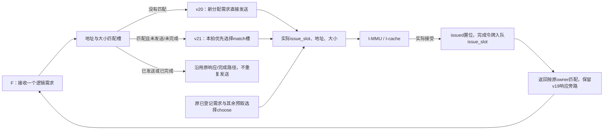
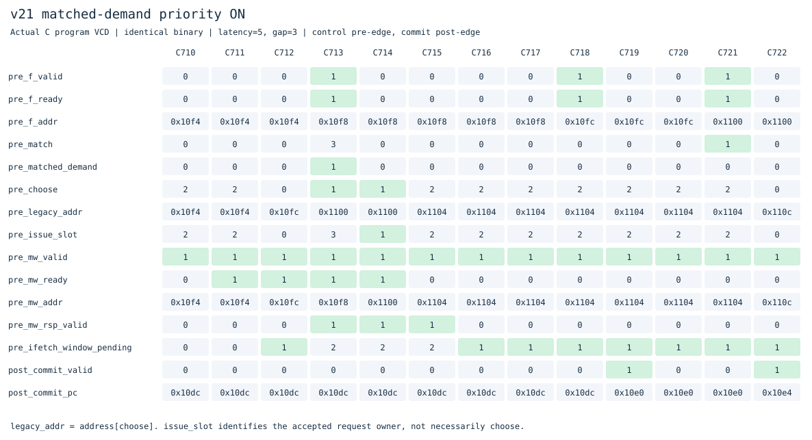
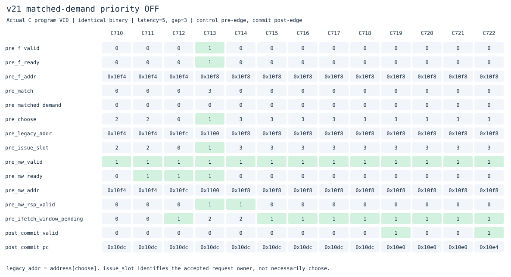

# v21：匹配到未发送槽的需求优先发送

本版在独立目录接着[v20新需求当拍发送](../v20_demand_issue/README.md)。仍是F/X/W单发射、顺序执行提交，四项完整指令FIFO与四槽读取窗口分开；v1–v20源码冻结，直接提交主分支。

## 从测量决定修改范围

v20只旁路没有匹配槽、需要新分配的需求。如果F需要的地址已经在一个未发送预取槽里，窗口会登记这个需求，但本拍的旧选择器还可能先发别的预取。

先用[`profile_ifetch.py`](../../tools/profile_ifetch.py)统计真实VCD，在延迟5/请求间隔3条件下：

| v20程序 | 接受时匹配未发送槽 | 当拍I侧就绪 | 当拍发出需求 | 当拍先发其他槽 |
|---|---:|---:|---:|---:|
| 裸机C | 45 | 24 | 21 | 3 |
| 分支冲突 | 69 | 63 | 62 | 1 |
| 直线ALU | 102 | 34 | 34 | 0 |
| 压缩依赖 | 18 | 0 | 0 | 0 |

因此存在可修正的调度机会，但大量等待是I侧未就绪，不能靠改变选择顺序消除。本版只处理实际需求被其他未发出预取抢先的情况，不把全部等待都算成潜在收益。

## 关键逻辑



新增开关`DEMAND_PRIORITY=1`。`matched_demand`要求：本拍F↔窗口真的接受需求、地址和大小找到有效非poison槽，而且槽尚未`issued`、尚未`done`。

实际发送槽优先级为：新分配真实需求、刚匹配的未发送需求、原登记需求、其余预取。v20的`direct_demand`和v21的`matched_demand`互斥；不能用未接受的F输入随意改变实际需求状态。

本版复用已有槽，不增加分配，不改变其保存的预测元数据。下游接受时用实际`issue_slot`记录令牌与issued；下游背压时没有实际发送，需求仍被登记，之后继续优先尝试。F↔窗口的ready仍不依赖下游ready，原注册响应级保留。

已经接受的I侧事务不能被抢占或取消，返回仍按实际接受顺序归属原槽。已发送/已完成槽不重复请求；旧poison响应与新需求即使地址相同，也必须分别按令牌解释。异常、中断、FENCE.I、SFENCE.VMA、satp切换的排空与权限检查沿用原路径。

**整核I侧在途峰值仍2笔，独立模型覆盖4笔，外部物理事务仍1笔。** 这是取指请求调度优化，没有增加流水线发射宽度或cache缺失MSHR。

## 真实波形：为什么choose与issue_slot不同





同一裸机C二进制、延迟5、请求间隔3；控制取沿前，提交取沿后。[开启CSV](docs/waveforms/priority-on.csv)、[关闭CSV](docs/waveforms/priority-off.csv)可查看逐拍值。

两版在C713遇到相同输入：F需要0x10f8，匹配槽3；旧选择器`choose=1`准备发送0x1100。开启时`matched_demand=1`、`issue_slot=3`，本拍发送0x10f8；关闭时仍发送0x1100，到C714才发送0x10f8。

`legacy_addr`是旧`address[choose]`，不是实际总线地址。完成令牌必须记录实际issue_slot，否则在这里就会把槽3的响应交给槽1。返回审计同时检查原owner、地址、数据、故障和poison，没有把重排读取次序当成乱序内存返回。

## 周期对比

实验[20261103T112719073706Z](../../results/comparisons/20261103T112719073706Z/comparison.csv)比较v16/v20/v21的19个相同二进制、三种内存条件，共171次主运行与171次关闭功能运行，每次逐条核对提交和完整RAM。

**v21关闭`DEMAND_PRIORITY`后，57组周期、外部请求、控制失误和提交数严格恢复v20。** 其他关闭配置也逐条参考校验；父版未选入本轮时不宣称进行了父版逐项对照。

相对v20，57组中**8组改善、49组持平，没有测到周期退步**。这是该测试集的结果，不是所有程序必然更快的保证。相对v16仍只有3组更快、54组更慢。

| 程序与条件(latency,gap) | v16 | v20 | v21 |
|---|---:|---:|---:|
| 裸机C (1,0) | 332 | 375 | 370 |
| 裸机C (5,0) | 674 | 724 | 715 |
| 裸机C (5,3) | 847 | 907 | 903 |
| 分支冲突 (5,3) | 367 | 479 | 475 |
| 压缩依赖 (5,0) | 388 | 354 | 336 |
| 直线ALU (5,3) | 1359 | 1375 | 1375 |
| 分页循环 (5,3) | 735 | 763 | 763 |
| 调用/返回 (5,3) | 227 | 231 | 231 |

裸机C的(5,3)外部请求保持94次、控制失误保持9次；分支冲突的外部请求保持15次、控制失误保持33次。这里的收益来自取指调度与等待变化，没有把它解释为外部请求减少或预测准确率提高。

额外的[定向程序开关对照](results/20261103T112719073706Z/priority-ablation.csv)也保留持平项：跳过错误路径的程序在(5,0)只省1周期，在(5,3)持平；FENCE.I和改变间接目标的样例持平。需求优先并不意味着每次改选都减少总周期。

## 剩余等待在哪里

[三版真实VCD统计](results/20261103T112719073706Z/priority-profile.json)中，v21的裸机C有49次匹配未发送槽，I侧就绪的26次全部当拍发送需求，没有先发其他槽；v20则有3次先发其他槽。两版执行节拍不同，事件总数也会变，不能用次数直接计算净省周期。

把“已登记的需求仍未发送”的周期进一步分成互斥类别，在(5,3)下：

| v21程序 | 未发送需求占用周期 | I侧未就绪 | 当拍实际发送 | 就绪却选择其他槽 |
|---|---:|---:|---:|---:|
| 裸机C | 345 | 318 | 27 | 0 |
| 直线ALU | 722 | 654 | 68 | 0 |
| 分页循环 | 82 | 76 | 6 | 0 |
| 压缩依赖 | 137 | 119 | 18 | 0 |

这说明继续堆叠槽位选择规则不是当前主要方向。I侧未就绪还需区分cache缺失/背景补行、MMU遍历、响应交接及共享物理仲裁，不能直接等同于外部内存忙。下一阶段应先定位这些服务阻塞，再评估缺失期间服务其他命中请求等改动。

## 验证与复现

```sh
make lint test
make test-priority
make synth
make diagrams
# 仓库根目录
make compare BENCHMARK_ARGS="--versions v16_ifetch_pipeline v20_demand_issue v21_demand_priority --cycles-only"
python3 tools/profile_ifetch.py versions/v21_demand_priority/build/priority-profile-c_demo.vcd
```

保留v20全部ISA、特权/异常/中断、Sv39/TLB、缓存、预测器、队列及窗口回归，新增：

- 启用/关闭各29组端口驱动定向测试，构造低编号无关预取抢先的情形；开启消除6次基线抢先发送。覆盖背压、故障、已发送/完成槽不重发、同地址旧poison和新需求、冲刷及暂停。
- 窗口随机事务模型启用/关闭各40000周期、峰值4笔；按实际接受事务独立记分，不用内部状态注入。
- 新增25次整核运行、3340次提交，另外30次开关运行；含裸机C、跳过错误存储/非法指令、FENCE.I自修改和改变间接目标。
- 10个实际整核VCD逐拍重放优先级、实际发送槽、令牌/owner、数据和故障。开启时每次“匹配未发出需求且I侧就绪”都发送该需求；关闭样例仍能观察到其他预取抢先。
- 57组功能关闭恢复父版；Verilator lint与Yosys综合结构检查通过。

[验证汇总与哈希](results/20261103T112719073706Z/validation.json)保存实际回归数量、源码、日志、trace/RAM及所示波形摘要。原始VCD和完整构建日志在本地build目录，精简JSON/CSV与SVG入库。

本版可以作为一个有证据支持的调度优化保留；收益范围有限，尚未全面超过v16。本轮按当前学习安排不做STA、面积比较或门级仿真，额外选择逻辑的频率成本尚未测量。ISA和特权功能边界见[根README](../../README.md)。
