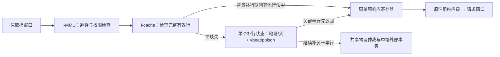
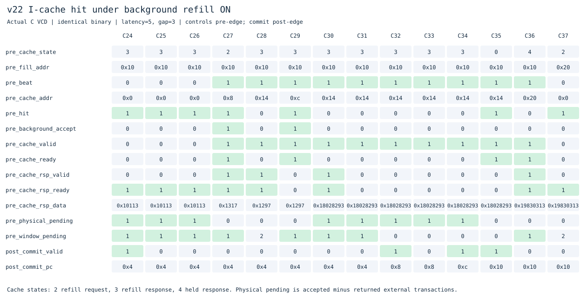
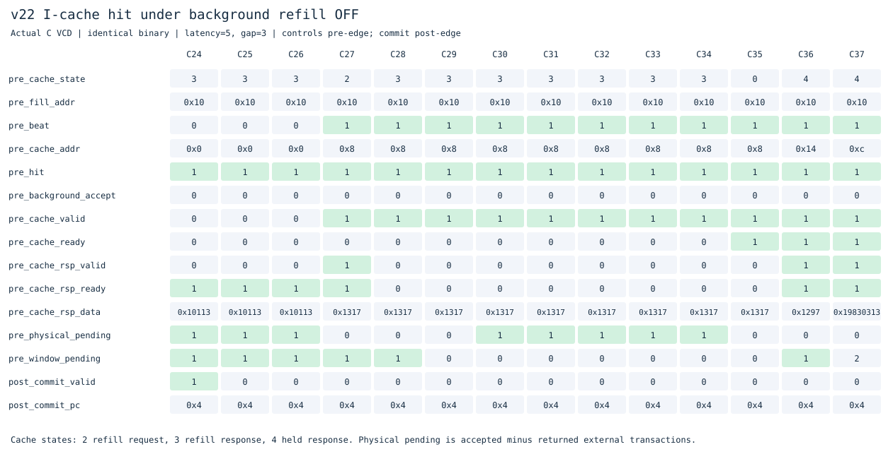

# v22：I-cache补行期间继续服务已命中行

本版在独立目录接着[v21需求优先发送](../v21_demand_priority/README.md)。仍是F/X/W单发射、顺序执行提交、四项完整指令FIFO和四槽读取窗口；v1–v21源码冻结。

## 先确认阻塞原因

新增工具[`profile_iservice.py`](../../tools/profile_iservice.py)，用沿前MMU/cache/物理仲裁状态划分I侧请求已提出、但未被接受的周期。它区分页表遍历、翻译后访问、故障响应、cache补行请求/响应、响应反压及旁路，并单独检查背景补行时是否挡住了一个已命中读取。

在延迟5、请求间隔3的v21中：

| 程序 | 提出请求但I侧未就绪 | 等补行请求接受 | 等补行响应 | MMU遍历 | 翻译后访问 | 背景补行挡住可服务命中 |
|---|---:|---:|---:|---:|---:|---:|
| 直线ALU | 1062 | 144 | 918 | 0 | 0 | 272 |
| 裸机C | 590 | 218 | 372 | 0 | 0 | 95 |
| 分页循环 | 163 | 47 | 94 | 21 | 1 | 32 |
| 压缩依赖 | 250 | 39 | 211 | 0 | 0 | 80 |

中间四个原因列构成这里的互斥划分，本表其他原因均为0；最后一列是其中的优化机会，不能再相加当总周期。请求可能是预取，不一定全是当前执行的关键需求。六个实际程序的完整[前后统计](results/20261103T131821117534Z/under-service-profile.json)同时保留物理仲裁竞争和响应等待信息。

因此本版先解除“背景补行期间，其他完整缓存行明明命中却不能接收”的限制。没有增加第二个缺失请求。

## 架构与关键规则



新增开关`ICACHE_HIT_UNDER_REFILL=1`，传入cache的`HIT_UNDER_REFILL`。只在I侧流水模式、early restart已启动、第一拍关键数据已返回且进入第二拍补行阶段时开放，并要求：

1. 输入是真正的缓存命中，行完整有效、tag正确；没有invalidate或补行poison。
2. 先前响应寄存器已空，或其响应将在本拍被接受。关键字响应必须排在所有年轻命中之前。
3. 请求仍经过原cacheable判定：执行读取、非写、非原子、64KiB可执行RAM内，大小与行边界合法。

接受命中时，只更新响应数据、error和available；补行地址、请求大小、beat与poison仍属于原缺失。命中不会生成新的外部内存请求。

**不读取部分有效行。** 正在补齐的索引已在缺失开始时失效，因此该行、冲突受害行、另一个缺失和MMIO/写/原子旁路都不能走新路径。它们继续等待补行或使用原路径。

## 最容易出错的交接

- **响应顺序：** 原关键字可在同一个时钟沿被消费，同时接收后续命中；新命中只能在之后返回。
- **反压：** 旧响应未被接收时不覆盖；后续命中已接受但F侧堵住时，仍保留数据和error，补行可以继续。
- **最后一拍碰到命中：** 成功补齐后若同拍接受新命中，状态必须保留该新响应，不能直接回IDLE而丢掉它。
- **尾部读取错误：** 原关键字已经成功返回时，补行尾部错误只让该行继续无效；不能将错误附到其他已命中行的响应上。同拍新命中仍返回其正确数据。
- **失效：** invalidate阻止新命中，并让旧补行保持poison，不能在其完成时重新置valid；已经接受的旧响应仍按原所有权排空。

MMU权限检查、提交、异常/中断、FENCE.I和上下文切换的排空不变；memory_system的busy继续包含背景补行。D-cache、物理仲裁和原子适配器没有修改。

当前RTL数组允许读已缓存行、并在补行结束时写另一索引；同拍命中的索引必然不同于失效中的补行索引。移植到单端口SRAM时需重新安排端口仲裁或存储结构。本轮没有验证SRAM宏、STA或面积，周期收益不能直接解释为频率收益。

## 实际开关波形





同一裸机C二进制、延迟5/间隔3，控制沿前、commit沿后采样。[开启CSV](docs/waveforms/under-on.csv)、[关闭CSV](docs/waveforms/under-off.csv)及[波形输入摘要](results/20261103T131821117534Z/under-wave-manifest.json)保留原值。

C27：正在补齐地址0x10所在行，`beat=1`，关键字响应正被消费。新请求0x8命中其他已缓存行。开启时`background_accept=1`、cache_ready=1，C28就返回0x8的字节；关闭时该请求继续被挡住，到C35才接受、C36返回。

开启图中C29又接受了命中的0xc，此时`physical_pending=1`，可以看到命中服务与未完成外部事务重叠。这里的cache_rsp是cache向MMU的响应，不等于指令当拍提交；`commit_pc`只在commit_valid为1时构成提交事件。

**外部物理事务峰值仍1笔，整核I侧服务在途峰值仍2笔，窗口独立模型仍覆盖4笔。** 允许的是背景补行下服务命中，不是多个缺失同时访存，也没有乱序响应。

## 完整性能对比

实验[20261103T131821117534Z](../../results/comparisons/20261103T131821117534Z/comparison.csv)比较v16/v21/v22的19个相同二进制、三种内存条件。171次主运行和171次关闭功能运行均逐条核对提交及完整RAM。

**v22关闭`ICACHE_HIT_UNDER_REFILL`后，57组周期、外部请求、控制失误和提交数严格恢复v21。** 其他关闭配置也经过独立参考校验；父版本未选入本轮时不宣称有父版本逐项对照。

在本轮57组中，v22全部比v21更快；相对v16，17组更快、2组持平、38组仍较慢。这是当前测试集结果，不保证所有程序和内存条件都更快。

延迟5、请求间隔3，周期越小越好：

| 程序 | v16 | v21 | v22 | v22补行下命中次数 |
|---|---:|---:|---:|---:|
| 直线ALU | 1359 | 1375 | 1107 | 134 |
| 裸机C | 847 | 903 | 855 | 34 |
| 压缩依赖 | 431 | 379 | 339 | 26 |
| 顺序求和 | 847 | 855 | 839 | 15 |
| 重复数据读取 | 855 | 863 | 847 | 15 |
| 分页循环 | 735 | 763 | 747 | 10 |
| 调用/返回 | 227 | 231 | 223 | 2 |
| 分支冲突 | 367 | 475 | 455 | 12 |
| 向前分支 | 339 | 367 | 343 | 8 |
| 间接调用 | 223 | 247 | 231 | 9 |

直线ALU的外部请求仍138次、控制失误仍0；裸机C仍94次外部请求、9次控制失误。这里的主要收益是命中与补行重叠，不是减少这些程序的外部读取或改善预测准确率。

仍有明显局限：裸机C、分页循环和若干分支样例尚未超过v16。向前分支的外部请求10→9等其他变化也保存在比较表，不能假设所有程序的请求数都不变。

## 优化前后统计与剩余工作

在同一内存条件下：

| 程序 | v21 I侧请求被挡周期 | v22被挡周期 | v21背景挡住可服务命中 | v22 |
|---|---:|---:|---:|---:|
| 直线ALU | 1062 | 835 | 272 | 0 |
| 裸机C | 590 | 552 | 95 | 0 |
| 分页循环 | 163 | 155 | 32 | 0 |
| 压缩依赖 | 250 | 266 | 80 | 0 |

压缩依赖的总周期379→339，但“提出请求且未接受”的计数反而250→266：前端更早推进后，会以不同节拍提出后续请求。它是重叠接口事件计数，不能单独用来排名性能，最终仍看完整程序周期。

剩余阻塞仍包含新行缺失与补行响应、D侧占用物理通道等。本版尚不服务未完成行中已经返回的半行，也不支持第二个缺失。下一步应测量这两类机会及请求窗口的无用读取，再选择改动，不直接同时增加所有复杂度。

## 验证与复现

```sh
make lint test
make test-under
make synth
make diagrams
# 仓库根目录
make compare BENCHMARK_ARGS="--versions v16_ifetch_pipeline v21_demand_priority v22_hit_under_refill --cycles-only"
python3 tools/profile_iservice.py versions/v22_hit_under_refill/build/under-profile-c_demo.vcd
```

保留v21完整ISA、特权/异常/中断、Sv39/TLB、缓存、预测与窗口回归，新增：

- 开关各20组cache定向用例：关键字顺序、多次连续命中、反压、补行最后一拍同时命中、成功/错误、失效、部分行、冲突、另一缺失、写/原子/MMIO旁路。
- 开关各120000周期随机模型，用独立字节与响应队列核对数据、顺序、反压和失效，并检查下游最多单笔。启用12408次响应/1042次补行下命中，关闭12132次响应/0次补行下命中。
- 关闭early restart、保留I侧流水时，原69项cache检查通过；原cache驱动增加沿前事件采样字段，避免把沿后组合值当作握手计数。
- 新增25次整核运行、4150次提交，另外30次开关运行；覆盖C、流式循环、调用、FENCE.I自修改和间接目标改变。
- 10个实际整核VCD独立重放cache接受/返回顺序、已缓存数据、响应反压、补行元数据保持、最终拍命中、窗口所有权和外部单笔事务。
- 57组关闭优化恢复父版；Verilator lint及Yosys综合结构检查通过。

[验证汇总及哈希](results/20261103T131821117534Z/validation.json)记录实际整核运行数、源码、日志、trace/RAM、审计及波形摘要。原始VCD和完整日志在本地build目录，SVG/CSV及精简报告入库。本轮未做STA、面积比较或门级仿真；ISA与特权功能边界见[根README](../../README.md)。

本版冻结，后续见[v23半行复用](../v23_fill_forward/README.md)。
