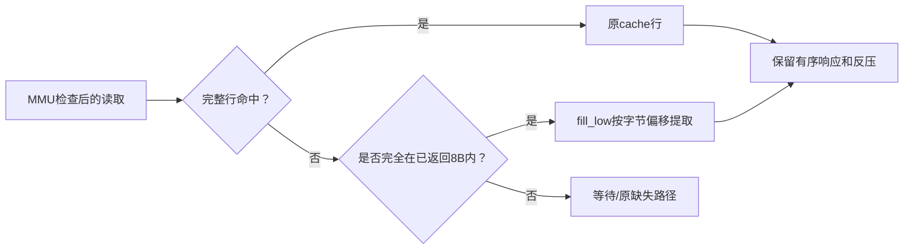
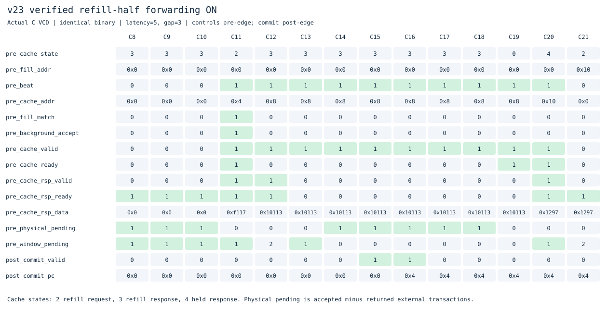

# v23：已返回补行半行转发，单发射收尾

接着[v22](../v22_hit_under_refill/README.md)，本版允许从补行缓冲中读取已经成功返回的8字节，而不是等整条16字节缓存行有效。首个返回半行可能位于行的低半或高半，始终用完整物理地址匹配。

`ICACHE_FILL_FORWARD=0`恢复v22。转发条件包括：early restart的关键半行已经返回、请求完全落在同一8字节内、原MMU权限检查通过、cacheable、没有invalidate/poison，并且单项响应寄存器可接收。它不把部分行设置为完整valid，不新增外部请求或MSHR。跨未返回部分、其他缺失、MMIO/写/原子继续等待。普通完整行命中与半行转发分别计数。





[关闭图](docs/waveforms/fill-off.svg)、[开启CSV](docs/waveforms/fill-on.csv)、[关闭CSV](docs/waveforms/fill-off.csv)。同一C程序在C11已有地址0所在8B半行，需求地址4不必等待另一半；输入摘要保留在实验记录。沿前采样控制、沿后采样commit。

验证覆盖低/高首半行、16/32位读取、跨8B拒绝、首拍错误、尾拍错误与转发同拍、持有响应、失效。尾部错误不污染已经返回半行中的正确字节；失效后不允许转发旧半行。启用/关闭各30组定向检查通过，启用120000周期随机字节/顺序/反压/失效模型通过，继承完整ISA/特权/异常/中断回归以及额外cache所有权审计。

## 相同比较与退步项

[20261103T135434524710Z](../../results/comparisons/20261103T135434524710Z/comparison.csv)新增一个适合观察供给上限的热循环，现代比较工具现有20个公共程序×3种内存条件。三版180次主运行、180次功能关闭运行逐条校验提交与完整RAM；60组关闭本功能严格恢复v22。

相对v22：49组更快、10组持平、1组退步；向前分支在(5,3)由343变为347周期，保留该结果。相对v16：29组更快、31组较慢。

延迟5/间隔3：

| 程序 | v16 | v22 | v23 |
|---|---:|---:|---:|
| 直线ALU | 1359 | 1107 | 1099 |
| 裸机C | 847 | 855 | 843 |
| 压缩依赖 | 431 | 339 | 307 |
| 顺序求和 | 847 | 839 | 839 |
| 热ALU循环 | 1451 | 1431 | 1419 |

热循环的代码落在I-cache内，共1300条提交，整体约0.92 IPC；冷启动和控制指令仍有成本。第16到112次循环的真实热区为960条指令/960周期，即1.00 IPC。[热区统计](results/20261103T135434524710Z/hot-throughput.json)从真实提交记录计算，不把整个程序IPC冒充纯ALU吞吐。这为进入多发射提供参照：下一阶段既要增加后端并行，也要检查每拍只生成一个完整指令包的前端上限。

## 复现与进入多发射

```sh
make lint test
make test-fill
make synth
make diagrams
# 仓库根目录
python3 tools/ifetch_experiments.py --versions v16_ifetch_pipeline v22_hit_under_refill v23_fill_forward --cycles-only
```

[验证汇总](results/20261103T135434524710Z/validation.json)保留源码、实际运行数和trace/RAM哈希。综合结构检查通过，本轮不做STA、面积或门级仿真。外部物理事务仍单笔，I侧服务峰值仍2笔。

单发射阶段到此保留一个可复现基线。下一目录开始保守双发射：首先只配对无异常、无依赖的ADDI/ADD/SUB，访存、分支和CSR继续沿原路径；需要额外寄存器读写端口、有序双提交、精确计数和完整回归。具体执行结果由双发射版本单独记录。
