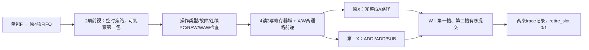
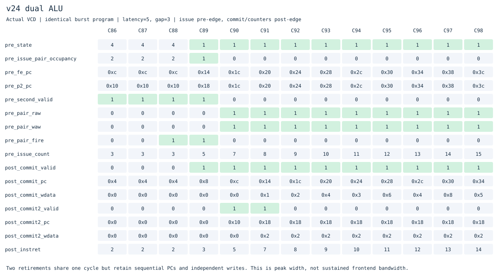

# v24：开始双发射——保守双ALU后端

[v23单发射](../v23_fill_forward/README.md)的热循环已测到960条/960周期，即1.00 IPC。本版开始多发射：两条相邻、合法、无RAW/WAW冲突的简单ALU指令可以同拍进入X、分别执行、在同一时钟沿按程序顺序提交。v1–v23源码冻结，当前目录独立开发。

**这是双发射起步版本，前端仍每拍最多生成一个完整指令包，不是持续2 IPC的完整双宽核。** 其他指令继续由原完整RV64IMAC/特权路径执行。

## 哪些指令能配对

仅支持ADDI、ADD、SUB及展开成这些指令的合法压缩编码。两包都不能有取指故障或压缩非法标记，必须是连续PC，并且各自预测后继为顺序地址。

| 情况 | 处理 |
|---|---|
| 两条独立的简单ALU指令 | 可同拍发射 |
| 第二条读取第一条目的寄存器（RAW） | 单发射，不做同对内前递 |
| 两条写同一非零寄存器（WAW） | 单发射 |
| 第一条读取第二条随后要写的寄存器（WAR） | 可配对，读操作数在写回前采样 |
| x0 | 始终为0，两条通路都禁止写入 |
| load/store、分支/JAL/JALR、M/A、CSR、系统指令 | 继续原单发射路径 |

## 硬件改变



前视队列支持空时直接传递第一包，也可把已经保存的一包与本拍到来的下一包配对；满时允许出队与入队同时发生。没有足够第二包时，不为凑对阻塞第一条。冲刷同时清空原FIFO和新增前视队列，所有故障、原始编码、长度、预测信息继续随包保存。

两条通路都有来自旧X/W两条通路的前递；较新的结果优先。第二条只能是不会产生执行异常的简单ALU，第一条也经过相同限制，因此不会出现“第一条已提交、第二条执行异常”需要部分提交的情形。访存、分支及异常恢复沿用原路径。

有配对时，W分别保存两个PC、原始指令、字节数、目的寄存器和结果；寄存器堆同沿写两个不同非零目的。architectural_pc更新到第二条后继，debug instret及CSR minstret按两条退休更新，mcountinhibit仍生效。中断停止接收年轻指令，但已发射的一对先完成，再从正确后继PC陷入。

新增逻辑会增加寄存器读写端口、前递和选择成本。本轮仅做综合结构检查，没有STA/面积或SRAM/物理端口实现测量。

## 三组配置，分清收益来源

| 构建 | 配置 | 用途 |
|---|---|---|
| full_obj | DUAL_ISSUE=1、PAIR_ENABLE=1 | 前视缓冲与双ALU |
| onealu_obj | DUAL_ISSUE=1、PAIR_ENABLE=0 | 同样缓冲，但只发射一条 |
| nodual_obj | DUAL_ISSUE=0 | 新队列完全旁路，恢复v23 |

[三组定向对照](results/20261103T142545956256Z/dual-ablation.csv)共99次运行，都逐条核对提交和完整RAM。例子：

| 程序/条件 | v23原路径 | 同缓冲单ALU | 双ALU | 双ALU峰值提交宽度 |
|---|---:|---:|---:|---:|
| burst (5,3) | 171 | 155 | 155 | 2 |
| WAR (1,0) | 92 | 92 | 91 | 2 |
| 前递 (1,0) | 90 | 90 | 88 | 2 |

burst的整体改善在这个配置中来自缓冲，不能把16周期都归给双发射；WAR/前递样例才观测到双发射本身额外减少1–2周期。峰值提交两条并不保证总周期按比例缩短。

## 真实波形



[同样缓冲但单ALU图](docs/waveforms/dual-onealu.svg)、[双ALU CSV](docs/waveforms/dual-on.csv)、[单ALU CSV](docs/waveforms/dual-onealu.csv)按相同指令PC对齐观察，时钟编号保留原值。

C89沿前，PC=0x14和0x18的两条独立ADDI同时发射；C91沿后，两槽分别提交结果1和2，instret从5变7。C90以后second_valid为0时，第二包组合值及RAW/WAW比较不表示有有效第二条指令。

原始trace在同一cycle输出两条独立commit，retire_slot分别为0、1，PC仍严格按程序顺序。参考模型只为合法第二槽允许同周期，仍检查每条指令、寄存器写、异常、内存和最终RAM；缺槽号、错误槽序、错误时间、错误写值/后继均被拒绝。第二槽不接受本版支持集之外的指令。没有通过把两个commit合成一条来隐藏检查。

## 相同程序比较与退步项

实验[20261103T142545956256Z](../../results/comparisons/20261103T142545956256Z/comparison.csv)：v16/v23/v24执行相同20个二进制、三种内存条件，180次主运行和180次关闭功能运行逐条参考校验。**60组DUAL_ISSUE=0的周期、外部请求、控制失误和提交数严格恢复v23。**

相对v23：20组更快、34组持平、6组退步；相对v16：33组更快、1组持平、26组较慢。退步项完整保留：位操作(1,0)62→63、(5,0)150→155、(5,3)191→195，C(5,0)666→670，完整M/A/C C程序(5,0)684→694、(5,3)799→811。新增缓冲及发射节拍改变了预取/训练/总线交错，尚未做全面性能调优。

延迟5、请求间隔3：

| 程序 | v23 | v24 | 配对发射次数 |
|---|---:|---:|---:|
| 求和 | 839 | 835 | 64 |
| 除法后独立指令 | 411 | 407 | 3 |
| 裸机C | 843 | 843 | 1 |
| 直线ALU | 1099 | 1099 | 0 |
| 热ALU循环 | 1419 | 1419 | 0 |

热循环仍1300条/1419周期，热区仍1.00 IPC。它没有积累第二包，前端单包供给已经成为持续双发射的上限。长延迟操作期间积累的包可以短时双发射；因此已经实现后端多发射，但没有宣称前端或整体吞吐已经双宽。

## 验证与复现

```sh
make lint test
make test-dual
make synth
make diagrams
# 根目录
make compare BENCHMARK_ARGS="--versions v16_ifetch_pipeline v23_fill_forward v24_dual_alu --cycles-only"
```

- 前视队列开关各50000周期独立FIFO模型，覆盖空时旁路、第二包来自输入、双出队、并发入队、满队列及冲刷。
- 新增56次整核运行、1331次提交、6次陷入，覆盖独立对、RAW/WAW、WAR、x0、X/W两通路前递、压缩编码、load后依赖、精确异常、CSR minstret和错误路径冲刷。
- 中断测试先从真实波形取得配对时刻，再在其下一拍注入外部中断；检查当时xp_valid与irq_stop同时为1，并用独立模型确认两条在途指令有序提交后再从正确PC接管。
- 12个整核VCD重放包FIFO、配对条件与双提交；5种损坏trace必须拒绝。
- 完整继承v23 ISA/特权/中断/Sv39/TLB/缓存/预测/原子与参考回归，保留原FIFO元数据检查，按新增前视队列的实际接口更新观测位置。
- 99次三组定向运行、60组恢复父版检查通过；综合结构检查通过。

[验证汇总](results/20261103T142545956256Z/validation.json)保存实际运行数、源码、trace/RAM、日志及波形摘要。原始VCD和完整日志在build，精简结果入库。仍无F/D/V/H、PMP、多核或Linux/正式ISA合规证明，本轮未做STA/面积和门级仿真。

## 下一阶段

已经达到“开始多发射”的阶段。下一步先设计双宽前端的边界：一次读取提供足够字节、两个有序解码包、混合16/32位长度、跨页故障以及分支切断第二槽；随后再扩展第二槽操作集和同对内RAW前递。暂不把双LSU、双分支或乱序一起加入。
