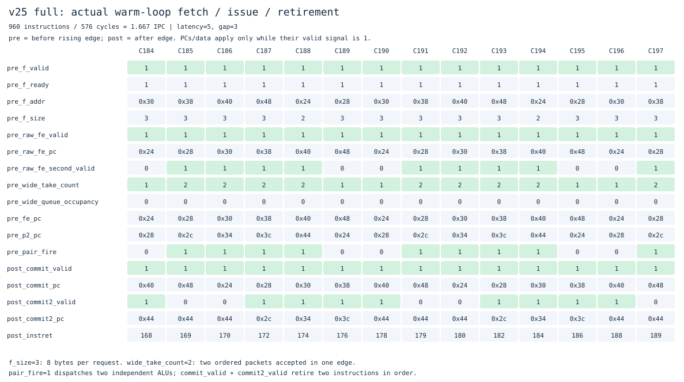

# v25：双指令前端，让双ALU获得持续供给

[v24](../v24_dual_alu/README.md)已有双ALU，但前端每拍最多形成一条指令，热循环停在1 IPC。v25保留原版本，新增独立目录；把取指返回利用、完整指令队列和预取路径扩展到最多两条指令，后端仍是保守顺序双发射。

相同热循环的稳定区间，**960条指令从960周期降到576周期，IPC从1.00提高到1.67**。这不是所有程序的平均IPC，也不是持续2 IPC：第二条只能配对ADDI/ADD/SUB，分支、访存、CSR等仍单发射。

## 为什么这样改

外部总线和cache补行本来就是8字节一拍；v24的F却通常只索取4字节、每拍最多交一个完整包。继续增加第二ALU的能力之前，应先消除供给限制。因此本版复用已有64位数据通路，增加第二个解压器和包出口，而不增加外部事务数量。


## 取指、混合长度与异常边界

- PC按8字节对齐时请求8B；仅按4字节对齐时请求4B；半字对齐时先请求2B，需要时再拼接32位指令。因此正常需求请求不会跨越4KiB页界。
- 从返回字中提取第一条，再判断余下字节是否包含第二条完整16/32位指令。不足时保存尾部，下一拍继续使用；32位前缀只有2B时，单独请求高半字所在地址，重新经过地址翻译和权限检查。
- 第一条预测跳转时切断顺序第二条。第二条若是分支/JAL/JALR/系统/CSR/fence，则留到下一拍作为第一条，由原BTB/gshare/RAS路径处理。没有增加第二个架构预测出口，也没有把两条分支当成普通ALU。
- 两包都保留PC、原始编码、展开指令、长度、预测后继和异常字段。第二条的压缩非法编码不会阻止较老合法指令完成；异常仍按程序顺序生效。
- `ready_slots`由队列返回本拍可接收的包数。若F持有两条而只能交一条，第二条完整元数据移到第一槽，不能重复发出已接收指令；反压时有效包保持稳定。重定向清空两槽和尾部，但已经接受的读取仍排空。

跨页例子：合法压缩指令位于0xffc，32位指令从0xffe开始。0x1000页取指失败时，较老指令仍正常退休；故障指令PC=0xffe、mtval=0x1000。宽取指独立单元和整核Sv39测试均检查这类情况。

## 队列与预取为什么也要改

宽模式用六项、双入口/双出口队列替代v24的“4项FIFO+2项前视”组合，存储总容量仍为六条。队空时可以直接交给后端；只有一条旧包时，可以观察本拍新包作为第二条。满时支持弹出两条并接收两条，环形指针及清空操作都接受独立模型检查。

第一轮实现采用注册输出、顺序8B预取，虽然能配对，却令许多程序变慢。最终版本恢复了队列旁路，并扩展预取查询：对齐8B字查询PC和PC+4两个只读预测副本，优先采用较早的跳转提示；高4B位置只查询当前PC。跟随目标按地址选择8B或4B读取。每个请求槽保存预测来自低/高32位，返回时用对应指令和真实PC复核类型、长度及直接目标。

这只是读取窗口的预取提示：它不提交指令、不训练预测器，也不能改变F/X的架构路径。可变长度控制流可能落在PC+2等位置，仍靠实际解码恢复。错误预取、跳转目标不匹配以及串行指令继续使用原来的令牌/毒化/失效机制。

I/D缓存仍各256B、行长16B；I/D TLB仍各8项；物理共享总线仍最多一笔外部事务。在整核VCD中I服务可观察到两笔已接受未返回，独立窗口模型峰值四笔。双包不等于双端口内存，也不等于两笔外部总线事务。

## 收益归因：三种配置

| 构建 | 变化 | 热循环总周期 | 稳定热区 |
|---|---|---:|---:|
| narrow_obj | WIDE_FETCH=0，恢复v24前端及队列 | 1419 | 960条 / 960周期 |
| onealu_obj | 宽前端、同一六项队列，PAIR_ENABLE=0 | 1423 | 960条 / 960周期 |
| full_obj | 宽前端 + 原双ALU | 915 | 960条 / 576周期 |

条件均为内存延迟5、接收间隔3，相同`hot_alu`二进制、1300条提交、结果1024。稳定区间以PC=0x24的第17次至第113次退休为边界，包含96次完整循环、分支和计数更新。宽前端单独不能突破单ALU的1 IPC；供给与执行宽度同时存在才产生这项提升。全程序周期下降35.5%，稳定热区周期下降40%。

[热区测量及trace/VCD哈希](results/20261103T162442591470Z/wide-warm-ipc.json)、[双发射三配置定向对照](results/20261103T162442591470Z/dual-ablation.csv)均保留。

## 实际波形怎么读



[窄前端对照图](docs/waveforms/narrow-hot.svg)、[宽模式CSV](docs/waveforms/wide-hot.csv)、[窄模式CSV](docs/waveforms/narrow-hot.csv)按同一热循环迭代采样，保留各自时钟编号。`pre_`是上升沿前，`post_`是沿后。

C185沿前，F交出PC=0x28和0x2c两条指令，`wide_take_count=2`、`pair_fire=1`；六项队列为空，可以旁路直接发射。C187沿后，`commit_valid`和`commit2_valid`同时有效，分别提交这两条指令，`instret`从170增加到172。连续几个周期都能重复双发射；PC=0x48的分支和回到0x24的4B需求使循环保留单发射周期，因此这里是1.67 IPC。

`f_size=3`表示一次读取8B，`f_size=2`表示4B。PC或第二槽组合值必须结合对应valid读取，valid=0时的旧数值不代表指令执行。

## 公共程序的完整对照

[20261103T162442591470Z](../../results/comparisons/20261103T162442591470Z/comparison.csv)包含20程序×3条件×2版本的120次主运行，以及120次关闭功能运行。二进制完全相同，每次逐条核对ISA提交和完整RAM。**60组WIDE_FETCH=0的周期、请求数、控制失误和提交数严格恢复v24。**

相对v24：18组更快、3组持平、39组更慢。60组总周期30927→30855，仅改善约0.23%；不能把热循环收益推广到整个程序集。

| 程序，延迟5/间隔3 | v24周期 | v25周期 |
|---|---:|---:|
| 热ALU循环 | 1419 | 915 |
| 完整M/A/C C程序 | 811 | 799 |
| 裸机C | 843 | 831 |
| 压缩程序 | 307 | 299 |
| 求和 | 835 | 855 |
| 相关依赖链 | 327 | 395 |
| 分支阶段变化 | 451 | 551 |
| 交替分支 | 475 | 635 |

宽读取改变了预取布局、训练时间和总线交错；第二条控制指令的回退、未对齐需求以及真实数据依赖也限制配对。周期退步完整保留，当前没有全面解决。尚未测量频率、面积、物理读写端口和门级实现，周期降低不能直接换算成硬件运行时间降低。

## 验证与复现

```sh
# 仓库根目录
make test VERSION=v25_wide_frontend
make test-wide VERSION=v25_wide_frontend
make lint VERSION=v25_wide_frontend
make synth VERSION=v25_wide_frontend
make diagrams VERSION=v25_wide_frontend
make compare BENCHMARK_ARGS="--versions v24_dual_alu v25_wide_frontend"
make check
```

完整`make test`通过：777次NativeSuite运行、77769条提交、259次预期软件陷入；另外包括71组基础参考运行、876条ALU向量×5条件、126组RV64I测试、99次双发射三配置对照和各功能关闭对照。宽前端独立测试510项，随机队列50000周期；完整333位包、预测索引、双提交、中断排空、缓存响应顺序和请求归属均有独立VCD模型。5种损坏双提交trace被拒绝。Yosys综合结构检查通过；按本轮范围没有运行STA或门级仿真。

[验证记录](results/20261103T162442591470Z/validation.json)、[测试摘要](results/20261103T162442591470Z/test-summary.txt)、[源码哈希](results/20261103T162442591470Z/implementation-hashes.json)用于复核。`build/`中保留原始trace、完整RAM和VCD，可由上述命令重新生成。

下一步优先研究第二槽控制指令与混合长度的路径供给，减少分支程序退步，再扩大双发射ALU操作集、加入同对内RAW前递。访存并行、乱序与多核仍是后续独立版本；本版没有新增这些功能。
