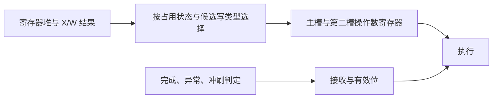

# v47 在最终接收判定前形成前递候选

v47 保留两槽空闲时采样操作数的行为，并把前递数据选择与最终接收资格拆开。X 槽有指令时，用指令的候选写寄存器类型和目的寄存器号选择前递值。异常判定、完成握手和冲刷继续决定这条候选指令能否被接收。

有效接收只发生于 X 空闲，或当前 X 完成且没有异常的周期。在这个条件下，候选写寄存器类型与原来经过异常限定的写使能相同，前递优先顺序也相同。组合等价检查覆盖这一条件下的全部数据和寄存器号组合，波形回放另外核对实际接收条件与锁存值。



| 布局布线前指标 | v41 | v44 | v47 |
| --- | ---: | ---: | ---: |
| 公共用例合计周期 | 26,312 | 26,312 | 26,312 |
| 展平寄存器间 setup 下限 | 7.0482 ns | 7.2037 ns | 7.0363 ns |
| 展平含端口 setup 下限 | 7.8034 ns | 7.9265 ns | 7.8188 ns |
| 分层寄存器间 setup 下限 | 9.3970 ns | 9.1002 ns | 9.3114 ns |
| 分层含端口 setup 下限 | 10.1179 ns | 9.8063 ns | 9.9658 ns |
| 展平标准单元面积 | 268,668.246 | 267,827.420 | 268,078.258 |

v47 在同一套周期下的展平寄存器间估计时间比 v41 短约 0.17%，并满足含 I/O 的分层 10 ns setup 约束。分层最差裕量仅 +0.0342 ns，结果仍属于布局布线前估计。展平含端口的下限比 v41 略长。v41 的分层含端口下限使用 v42 复核更正后的 10.1179 ns。

完整 Verilator 回归通过，回放验证了两槽停顿保持、接收时操作数、前递优先级和异常接收条件。60 组公共用例的全部计数、退休日志和最终 RAM 与 v41 一致。展平网表另通过 60 组公共用例及 59 组双发射专项的逐字节核对。v47 设为根目录默认版本。

[公共比较](../../results/comparisons/v47-forward-candidates/comparison.csv) · [公共门级对照](results/v47-forward-candidates/gate-equivalence.csv) · [双发射门级对照](results/v47-forward-candidates/pair-gate-equivalence.json) · [条件等价检查](results/v47-forward-candidates/forward-equivalence.json) · [完整时序](results/v47-forward-candidates/timing-summary.json) · [分层 I/O 路径](results/v47-forward-candidates/io-paths.txt)

```sh
make test VERSION=v47_forward_candidates
make timing VERSION=v47_forward_candidates CLOCK_NS=10
python3 tools/flat_timing.py v47_forward_candidates --output .local/timing/v47-flat
```
